# Bitrix24 CRM — Reference Analysis

> Research performed on **1 November 2026** against the reference portal `b24-m37f6k.bitrix24.com`
> (free plan, portal created 28 Oct 2026, one user: the owner, role *Primary administrator*).
> Exploration was done with a scripted Chromium browser using the owner's own signed-in session,
> plus Bitrix24's in-page REST API (`BX.rest.callMethod`) to read the exact data model.
>
> Every statement below is tagged:
>
> | Tag | Meaning |
> |---|---|
> | **[Tested]** | We performed the action in the reference portal and observed the result. |
> | **[Observed]** | We saw the screen/setting but did not exercise it end-to-end. |
> | **[API]** | Read from Bitrix24's REST metadata (field lists, enums, stages). |
> | **[Blocked]** | We tried, but the portal/plan/network prevented it. |
> | **[Assumed]** | Not verified; based on product conventions. Treat with caution. |
>
> Screenshots live in [`screenshots/`](screenshots/). Test records are prefixed `TEST-QA`.

---

## 1. What Bitrix24 is (and what part of it we care about)

Bitrix24 is an all-in-one "business suite": intranet (Feed, chat, Drive, calendar, workgroups),
task/project management, telephony, contact center, website builder, online store, inventory,
e-signature, HR — **and** a CRM. The CRM is only one module inside a much larger shell, and many
of its UX problems come from that: the CRM shares navigation, notifications, upsell banners and
design language with dozens of unrelated tools.

Our scope is the **CRM**: leads, deals, contacts, companies, products, activities/tasks,
pipelines, automation, permissions, reports and settings.

### 1.1 Global shell **[Observed]**

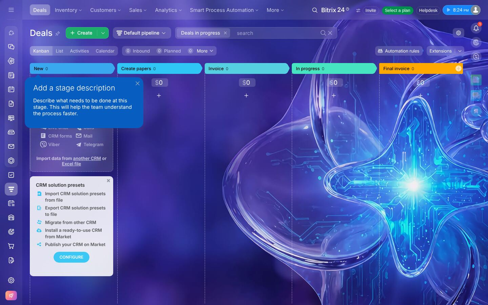

The CRM page has **four navigation surfaces at once**:

1. **Left icon rail** (≈20 unlabeled icons: chat, feed, CRM, tasks, calendar, drive, sites, store…).
2. **Top horizontal menu** that changes per module (CRM: *Leads, Deals, Inventory, Customers,
   Sales, Analytics, Smart Process Automation, More*), each item a dropdown.
3. **Right rail** (notifications, CoPilot, "open channels", recent chats, avatars).
4. **In-page view switcher** (*Kanban · List · Activities · Calendar*) + counters
   (*Inbound, Planned, More*) + *Automation rules* + *Extensions*.

Persistent upsell elements are always on screen: **Select a plan**, **Upgrade your plan**,
promotional banners (e.g. "Vibe+ Launch Offer – up to 40% off", screenshot 07),
and locked items inside menus.

Details open in a **side slider** (an iframe over the list). URLs are stable
(`/crm/deal/details/{id}/`) and open full-page when visited directly.

### 1.2 CRM modes: Simple vs Classic **[Tested]**

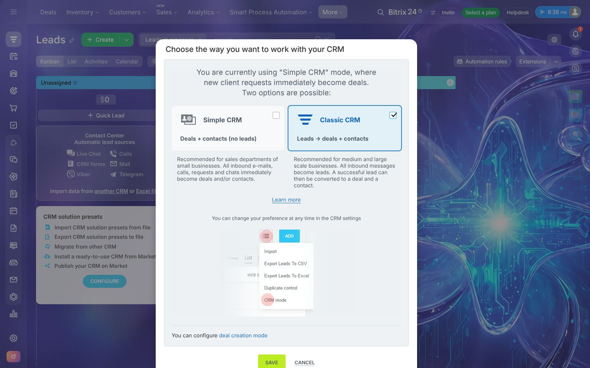

The portal started in **Simple CRM** mode (*Deals + contacts, no leads*): every inbound request
becomes a deal directly. Opening *Leads* shows a modal offering **Classic CRM**
(*Leads → deals + contacts*). We switched to Classic (`crm.settings.mode.get` changed `2 → 1`).
After the switch the *Leads* menu item appears and the lead Kanban becomes usable.

> Insight: the lead stage is optional in real businesses. Our CRM should support both
> (a workspace setting "Use leads"), but present it as a simple toggle, not a modal ambush.

---

## 2. Module breakdown

### A. Dashboard / Home

| Finding | Tag |
|---|---|
| There is **no CRM dashboard**. The portal home is the intranet *Feed* (posts, "Welcome to Bitrix24!", My Tasks widget, app download links). | Observed (`23-dashboard`) |
| The CRM "start" URL `/crm/` redirects to the Deals list. | Tested |
| KPI dashboards ("Deal analytics summary", "Key performance indicators", "Lead generation", "Sales trend"…) are **BI Builder** boards, locked behind the *Standard* plan or higher. | Blocked (`62-deal-analytics-summary`) |
| Counters on the Deals page (*Inbound*, *Planned*, overdue badge) act as a mini-dashboard. | Observed |

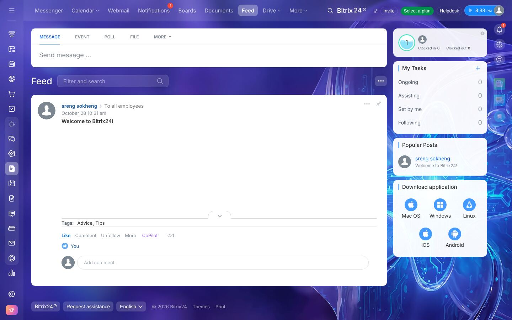

### B. Deals

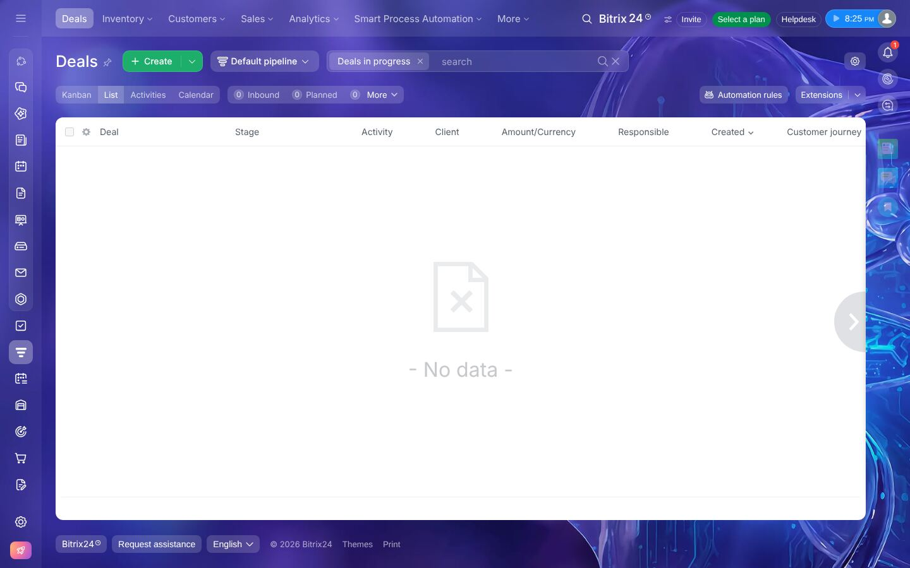

**Views [Tested/Observed]:** Kanban (default), List (grid), Activities (Kanban grouped by
*next-activity due date*: Overdue / Due today / This week / Next week / Idle / Later —
screenshot 03), Calendar (deals placed by *close date*, screenshot 99).

**Pipelines [Tested]:** A deal belongs to exactly one *pipeline* (`CATEGORY_ID`). The default
pipeline has stages
`New → Create papers → Invoice → In progress → Final invoice → (Deal won | Deal lost | Analyze failure)`.
We created a second pipeline *TEST-QA Partnerships* from *Sales pipelines and tunnels*; it was
created with a **copy of the default stages** (screenshot 92). "Tunnels" connect a success stage of
one pipeline to a stage in another (we saw the UI, did not configure one).

**Stage semantics [API]:** every stage carries a semantic: `process` (P), `success` (S) or
`failure` (F). Exactly one success stage per pipeline; several failure stages are allowed
("Deal lost", "Analyze failure"). `STAGE_SEMANTIC_ID` and `CLOSED` are derived.

**Deal fields [API]** (abridged — see [DATABASE_SCHEMA.md](DATABASE_SCHEMA.md) for our model):
title, type (*Sales, Integrated sales, Merchandise sales, Services, After-sales service*),
pipeline, stage, previous stage, probability, currency, amount (`OPPORTUNITY`),
*amount calculation mode* (auto from products vs manual), tax, company, contacts (many),
*your company details*, estimate link, start date, close date, "available to everyone",
closed flag, comments, responsible, created/modified/moved by & time, source + source info,
originating lead, location, UTM fields, last activity time/by, last communication time,
repeat-deal / repeat-inquiry flags, recurring flag.

**Creation [Tested]:**
- *Create* button → full form in a slider.
- *Quick Deal* inline form at the top of the first Kanban column (title, amount+currency,
  contact, company, "Select field") — screenshot 53. Saved instantly.
- Empty title is allowed; Bitrix24 auto-names it `Deal #N` (verified on leads, same component).

**Kanban [Tested]:** column header shows stage name + count; under it the **sum of amounts**.
Cards show title, amount, contact, company, relative age, quick icons (call/email/chat),
"+ Activity", responsible avatar. **Drag-and-drop between stages works**; totals update live
(screenshot 56). Moving fires stage automation (a system notification appeared).
If a required field is missing, the drop is intercepted by a **mini-form asking only for the
missing field(s)** (screenshot 79) — an excellent pattern.

**Closing [Tested]:** clicking the final segment *Close deal* on the stage bar opens
"Finalize … select the processing result: **Deal won | Failure**" (57). *Failure* asks for the
failure stage (*Deal lost | Analyze failure*) (59). On close: all stage segments turn green
(won) or red (lost), `CLOSED=Y`, and **close date is overwritten with today** (was +7 days).
An "Item moved to stage … **Cancel**" undo toast appears for a few seconds.

**Deal detail [Tested]** (screenshot 58): header with title (inline rename), pipeline switcher,
call/email/chat icons, *Extensions*, settings gear, *Document*, primary split button (*Estimate*).
Stage bar. **Tabs:** General, Products, Estimates, Automation, Workflows, Invoices, Dependencies,
History, Market, More. Left column = field sections ("About deal", "More", "Products") with
**empty fields hidden in view mode**; right column = **timeline**.

**History [Tested]:** the *History* tab is a field-level audit log: "Stage changed Invoice →
Deal won", "Field 'Finished on' changed 11/08/2026 → 11/01/2026", "Amount $0 → $15,000",
"Product added", "View", "Added linked entity …" (screenshot 97). A global CRM history exists at
*More → History* (`/crm/events/`).

**Defaults observed [Tested]:** new deal end date = **today + 7 days**, type = *Sales*,
responsible = creator, "available to everyone" = Yes, currency = USD (base currency).

### C. Leads

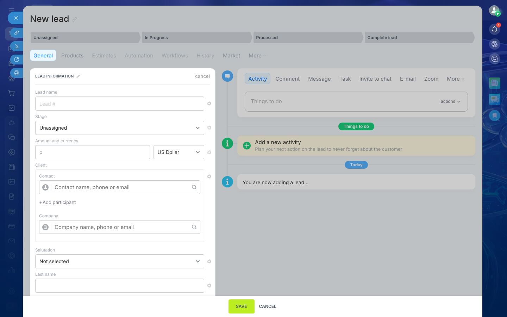

| Behaviour | Tag |
|---|---|
| Lead stages: `Unassigned → In Progress → Processed → (Good Lead ✓ | Junk Lead ✗)`; final success is internally `CONVERTED`. | API / Observed (14) |
| Sources dictionary: Call, E-Mail, Website, Advertising, Existing Client, By Recommendation, Show/Exhibition, CRM form, Callback, Sales boost, Online Store, Other, Booking, Repeat sales. Editable. | API / Observed (103) |
| **No field is required.** Saving an empty form created `Lead #1` with source = **Call**, stage = Unassigned, responsible = me, "available to everyone" = Yes. | Tested (33) |
| Lead holds *personal* data (salutation, first/middle/last name, birthdate, position), *company name* (free text), multi-value phone/email/website/messenger, amount, address, UTM, comment, observers. | API / Tested |
| Phone input has a country-code picker that defaulted to **+855 (Cambodia)** — probably from the browser/IP locale. | Observed (42) |
| Stage change from the stage bar is a single click and is logged. | Tested (41) |
| Lead list default filter is *Leads in progress* — converted/junk leads disappear from the default view. | Tested (105) |

**Conversion [Tested]** — see [CRM_WORKFLOWS.md §3](CRM_WORKFLOWS.md#3-convert-lead-into-deal--contact--company).
The primary header button is **"Deal + Contact + Company"**; its dropdown offers
*Deal + Contact, Deal + Company, Deal, Contact + Company, Contact, Company, Select from list…*
(screenshot 44). One click created Deal #1, Contact #1, Company #1, copied data across,
set the lead to `CONVERTED`, opened the new deal, and **re-bound the lead's activity to all four
records**.

### D. Contacts

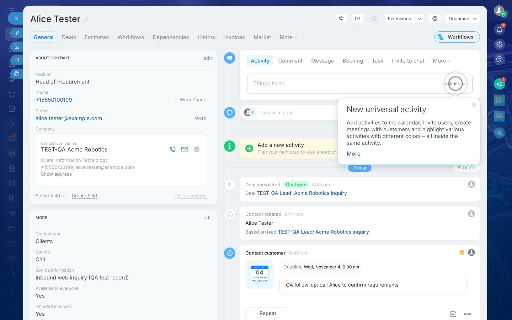

- Fields **[API]**: salutation, first/second/last name, photo, birthdate, type (*Clients,
  Suppliers, Partners, Other*), source, position, address, comment, "available to everyone",
  "included in export", responsible, company (primary) + **many companies** (`COMPANY_IDS`),
  originating lead, UTM, multi-value phone/email/web/messenger.
- Detail tabs **[Observed]**: General, Deals, Estimates, Workflows, Dependencies, History,
  Invoices, Market, More.
- The timeline on a contact **aggregates the history of linked records** (lead creation,
  comments, deal won) — the contact acts as the customer 360° view **[Tested]**.
- List view: columns *Contact, Activity, Responsible, Created, Customer journey* **[Observed]**.
  Paging is 20 per page; the total count is hidden behind **"Total: Show quantity"** **[Tested]**.

### E. Companies

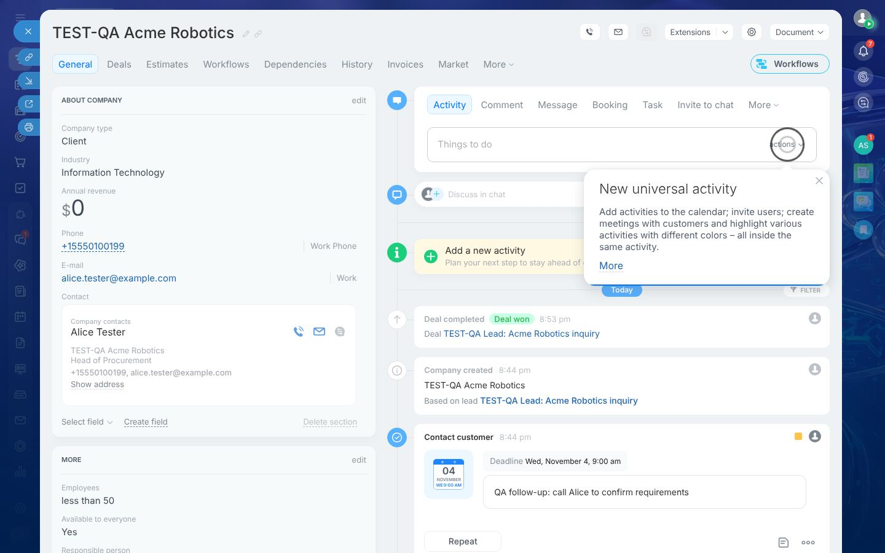

- Fields **[API]**: name (required), type (*Client, Supplier, Competitor, Partner, Other*), logo,
  street + billing address, banking details, industry (*IT, Telecom, Manufacturing, Banking,
  Consulting, Finance, Government, Delivery, …*), employees bracket (*<50, 50–250, 250–500, >500*),
  currency, annual revenue, "My company" flag (your own legal entities), responsible,
  contacts (many), lead, UTM, multi-value channels. Requisites (legal details) presets:
  *Company*, *Person*.
- Conversion created the company with **type = Client, industry = IT, employees = <50** —
  defaults filled silently **[Tested]**.

### F. Activities & tasks

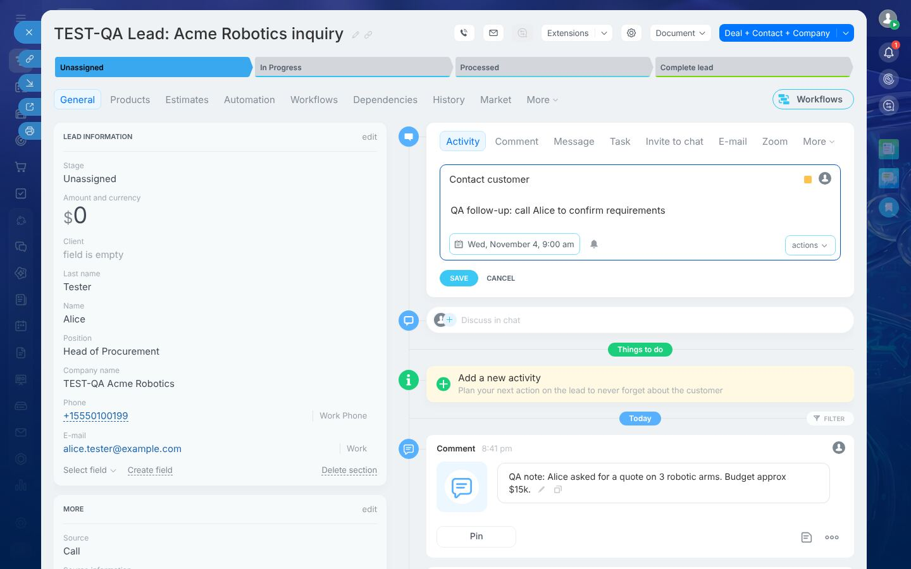

Bitrix24 distinguishes **four** things in the timeline:

| Concept | What it is | Tag |
|---|---|---|
| **Comment** | Free text note on the record, pinnable, supports mentions & files. | Tested |
| **Activity ("To-do", universal activity)** | Default title *Contact customer*, description, **deadline** (default ~3 days ahead, 9:00), color, responsible, reminder bell; *actions*: add to calendar, select customer, invite users, address, location, attach link/file. Shows a **Completed** button and an editable deadline chip. | Tested (38, 40) |
| **Typed activities** | Enum `TYPE_ID`: Meeting, Call, Task, E-mail, Activity, User action; provider-based (calls, emails, open-channel chats, bookings, Zoom…). Status: Pending/Completed/Auto-completed; direction: incoming/outgoing; priority low/normal/high. | API |
| **Task** (Tasks module) | Full task object (owner, assignee, deadline, checklist, observers, sub-tasks, time tracking, Gantt…) linked to CRM via `UF_CRM_TASK = ["D_1"]`. Title is prefilled "CRM: {deal title}", tag `crm`, deadline default ~1 week. | Tested (64) |

- One activity can be **bound to several records** (lead + deal + contact + company):
  `crm.activity.binding.list` returned 4 bindings after conversion **[Tested/API]**.
- Converting the lead **auto-completed** its open to-do **[Tested]**.
- *My activities* (`/crm/activity/`) lists the current user's open activities across records
  **[Tested]**.
- The Kanban **Activities** view groups deals by next-activity due bucket **[Observed]**.

### G. Products

| Finding | Tag |
|---|---|
| Product fields: name (required), price, currency, code, description, active, section/category, sort, VAT rate, VAT included, unit of measure, images, external ID. | API |
| Units: metre, litre, gram, kilogram, piece (default `pcs.`). Currencies: USD (base), EUR, CNY, BRL, INR. | API |
| Deal *Products* tab: rows of *Product (find or create), image, Price, Quantity, Amount*, gear for more columns (discount, tax); summary *Total without discounts and taxes, Delivery price, Discount amount, Total before tax, Tax total, **Total amount***. | Observed (47, 52) |
| **The product catalog is broken on this portal**: `/crm/catalog/` and Inventory → Products show "Cannot find the specified information block"; inline "Create: TEST-QA Robotic Arm X1" and `crm.product.add` both fail with *Incorrect information block code*. | **Blocked** (46, 49) |
| Free-text product rows (no catalog product) can be saved via API. Row semantics: `PRICE` is the **final unit price after discount**; a 10 % discount on a $1,500 row stored `DISCOUNT_SUM 166.67` and showed list price 1,666.67. | Tested / API |
| With those rows the summary showed *Total amount $0* while row amounts summed to $15,000 — totals were inconsistent (likely a side-effect of the broken catalog). We set the amount manually (*calculation mode: Manual*). | Tested (52) |
| Products also exist on leads, estimates and invoices (same row model, `OWNER_TYPE`). | API |

### H. Automation

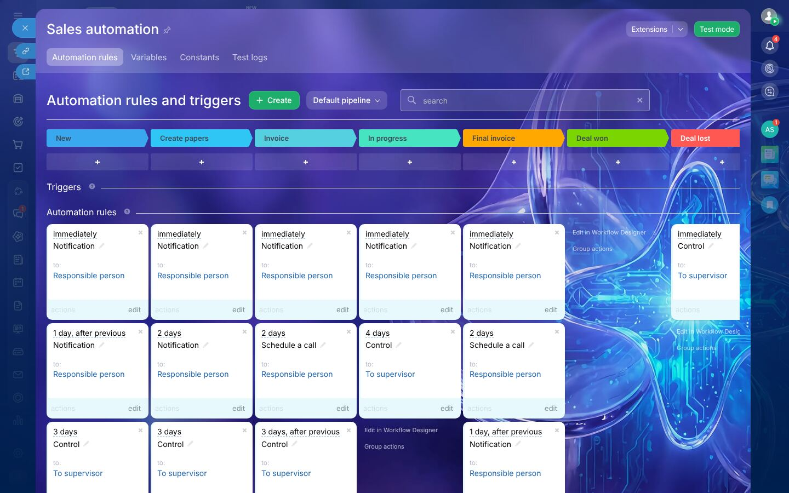

- **Automation rules ("robots")** are configured **per pipeline, per stage**, in a board whose
  columns are the stages **[Tested]**. The default pipeline ships with ~15 rules: notifications to
  the responsible person, "Schedule a call", and "Control → To supervisor" after N days.
  These fired during our tests (system notifications on deal creation and on entering *Invoice*).
- **Triggers** are a separate row: events that *move* the item to that stage (email opened,
  link clicked, form submitted, task status, field value changed, invoice paid, …) **[Observed]**.
- Adding a rule opens a catalogue grouped by purpose (68): Customer communication, Employee
  alerts, Employee monitoring & control, Paperwork, Payment, Delivery, Repeat sales, Ads,
  Manage workflow items, Customer information, Products, Task management, Data storage &
  modification, Workflow automation, Other, Market. Examples: *Send email, Add notification,
  Add comment to item, Create task, End task, Notify supervisor, Modify item, Change stage,
  Change responsible person, Change observers, Modify contact/company, Add product item,
  Copy/move product items, Create payment link, Math operations, Modify variable*.
- Each rule has **Execution** (*Wait* for previous rule vs *In parallel*), **Time** (*Immediately*,
  N days/hours after, before a date field, exact time; respect working hours), **Condition**
  (field-based), and action-specific settings **[Tested]** (71).
- We added *"Add comment to item: QA automation: deal entered New stage"* (immediately, parallel)
  on *New*, saved, and created a deal → the comment appeared on the deal within seconds **[Tested]**.
- *Test mode*, *Variables*, *Constants*, *Test logs*, and "Edit in Workflow Designer" (full BPMN-like
  business-process designer) exist **[Observed]**. The legacy `/bizproc/` URL is 404.

### I. Users, teams and permissions

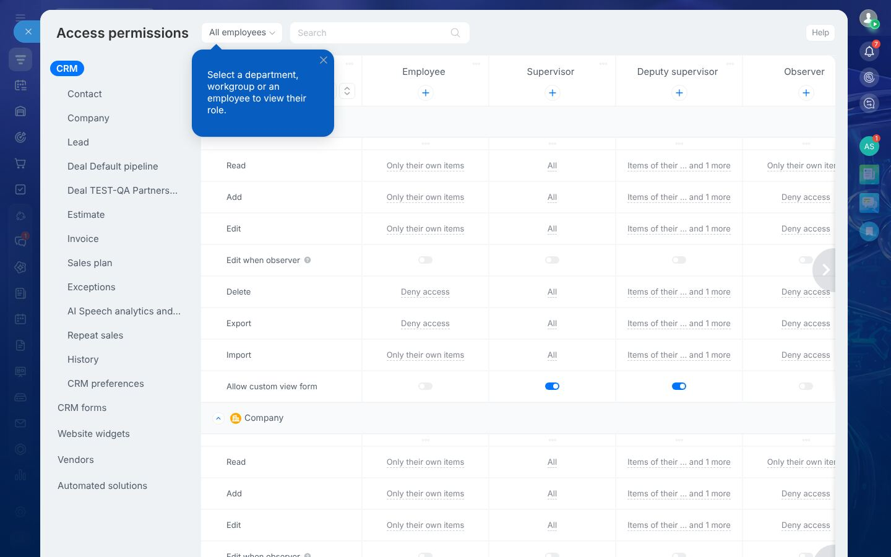

- Users live in the intranet *Employees* list with departments ("Company Structure") **[Observed]**.
  We did **not** invite users — that sends a real email invitation, which is out of scope.
- **CRM permissions are role-based** **[Observed]**: default roles *Employee, Supervisor, Deputy
  supervisor, Observer, Administrator* ("5 out of 5" — the role count is plan-limited).
- The matrix is *entity × action × role*. Entities: Contact, Company, Lead, **Deal per pipeline**,
  Estimate, Invoice, Sales plan, Exceptions, Repeat sales, History, CRM preferences, CRM forms,
  widgets, vendors. Actions: Read, Add, Edit, Edit when observer, Delete, Export, Import,
  Allow custom view form; leads/deals add *Automation rules*, *Amount on kanban stages*
  (Show/Hide), *Move to stage*.
- Each cell is a **record scope** (94): *Only their own items · Items of their department ·
  Items of their subdepartments · Items of their teams · Items of their teams and subteams ·
  Items available to everyone · All items of all employees* (multi-select) or *Deny access*.
- "Available to everyone" (`OPENED`) on each record feeds the *items available to everyone* scope.
- Roles are assigned to users, departments or workgroups ("All employees" selector).
- We did not save permission changes (single-user portal; behaviour could not be observed from a
  second account) **[Blocked]**.

### J. Reports & analytics

| Report | Status |
|---|---|
| Standard reports (`/crm/reports/report/`): *Won deals, Deals by contact, Deals by company, Deals by sales representative, Expected sales, Overdue deals, Deals by stage, Product sales, Leads by manager, Leads by stage, Leads by source, Managers' activities*. Each has a chart (some), a table with totals, a filter panel (period, type, company, contact, responsible) and an "About report" note. | **Tested** — reflected our test data correctly (63) |
| Analytics menu (18 items: ABC analysis, Cohort analysis, Deal analytics, KPI, Lead generation, Customer churn, Ad ROAS, Call analytics, Sales trend, Real-time analytics…) | **Blocked** — BI Builder, requires paid plan (62) |

*Deals by sales representative* computed: 2 deals, 0 in progress, 50 % lost, 50 % won,
average deal 8,750, opportunity total 17,500, won amount 15,000 — exactly matching our actions.

### K. Settings & customization

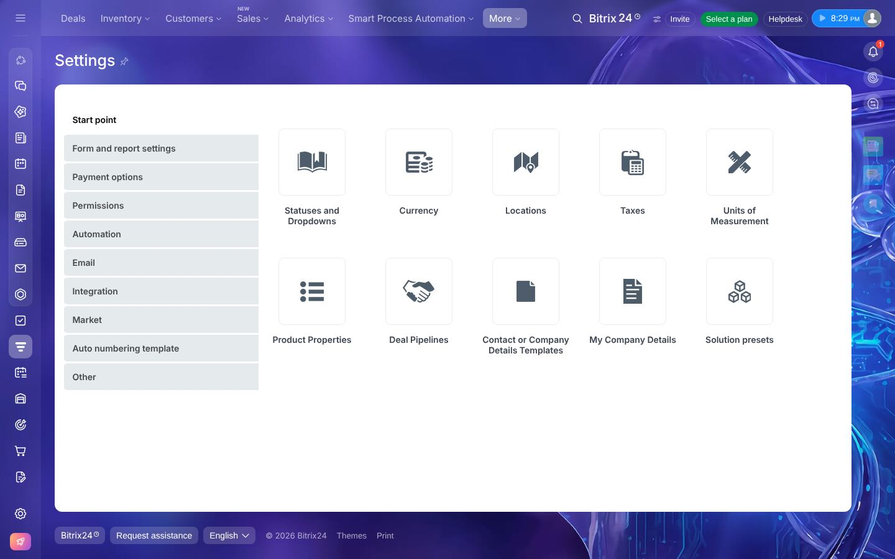

- *Settings* start point: Form & report settings, Payment options, Permissions, Automation,
  Email, Integration, Market, Auto-numbering templates, Other; tiles for *Statuses and Dropdowns,
  Currency, Locations, Taxes, Units of measurement, Product properties, Deal pipelines,
  Contact/Company details templates, My company details, Solution presets* **[Observed]**.
- **Selection lists** (`/crm/configs/status/`): editable dictionaries for lead stages, sources,
  contact type, company type, employees, industry, deal type, invoice stages, **deal stages per
  pipeline**, estimate stages, salutations, call statuses, document stages. Stage editor has
  *Initial / Additional / Final (Success | Failed)* zones with drag ordering, colors, plus a
  "Scale preview" and "Funnel preview" (102) **[Observed]**.
- **Custom fields** (15, 73): types *String, List, Date/Time, Date, Book a resource, Rich text,
  Address, Link, File, Money, Yes/No, Number*, and under "Additional fields": integer, bind to
  user, bind to CRM item, bind to dictionary, iblock section/element, and REST-defined custom
  types **[Tested/API]**.
  - Options: multiple, **required — for all stages or only from selected stages**, show always,
    tooltip, "Allow CoPilot to fill", visible to selected users only (75).
  - Fields can be created inline from any record ("Create field" link in each section) — by any
    user with "custom view form" permission.
  - **Required fields are enforced by the UI but not by the REST API**: `crm.deal.update` moved
    a deal to the next stage while the required field was empty; the Kanban drag of the same deal
    was blocked by the mini-form **[Tested]**.
- Form layout is customizable per user or "for everyone": sections, drag fields, "Select field",
  "Delete section", "Add section", "Use standard layout" **[Observed]**.
- Integrations: CRM forms, website widgets, open channels (Live chat, Viber, Telegram…),
  telephony, mail, Market apps, REST/webhooks **[Observed, not tested]**.

### L. Other CRM features discovered

| Feature | Notes | Tag |
|---|---|---|
| **Duplicate control** | Real-time popup while typing email/phone: "Matches found: 1 — 1 match by e-mail — Lead TEST-QA …". **Non-blocking**: the duplicate saved anyway. | Tested (42) |
| **Recycle bin** | Deleting asks "Are you sure?"; items go to *Recycle Bin* for **30 days** with Recover/Delete. **Recovered lead came back with a new ID (5 → 7).** | Tested (86, 87) |
| **Estimates (quotes)** | Stages *New → Sent to client → Accepted / Declined / Analyze decline*; product rows; created from a deal. | API / Observed (09) |
| **Invoices** (smart invoices) | Stages *New, Sent to customer, Paid, Unpaid*; linked to deal/estimate; "Receive payment" CTA on deals. | API / Observed (10) |
| **Smart processes (SPA)** | User-defined entity types with their own pipelines & fields. None configured. | Observed |
| **Customer journey / Sales Intelligence** | Column in lists; ad-traffic tracking ("Connect Sales Intelligence"). | Observed |
| **Repeat sales**, **Sales boost**, **CoPilot (AI)** | Present in menus; not tested. | Observed |
| **Calendar view** | Deals on a month grid by close date. | Observed (99) |
| **Mobile web** | Cramped; onboarding popovers cover the board (106, 107). | Observed |

---

## 3. Architectural observations (from the outside)

- **Entity type IDs** are global integers (`1 Lead, 2 Deal, 3 Contact, 4 Company, 5 Invoice(old),
  31 Invoice, 7 Estimate, 8 Requisite, 36 Document…`), and polymorphic references use them
  (`OWNER_TYPE_ID + OWNER_ID`, or short codes like `D_1`, `C_1`).
- **Multi-value channels** (phone/email/web/IM) are a separate table (`crm_multifield`:
  `TYPE_ID, VALUE_TYPE, VALUE`) shared by leads, contacts, companies — enabling cross-entity
  duplicate search.
- **Dictionaries** (stages, sources, types, industries) are one generic table
  (`ENTITY_ID, STATUS_ID, NAME, SORT, SEMANTICS, COLOR`). Pipeline stages are namespaced
  (`C1:NEW`).
- **Custom fields** are "user fields" `UF_CRM_*` (EAV-like storage per entity).
- **Activities** have **bindings** (many-to-many with CRM entities) and **providers** (call,
  email, to-do, task, booking…).
- **Timeline** is a separate stream mixing system events (created, stage changed, converted),
  comments and activities; History tab is a classic field-change audit log.
- IDs on this cloud portal increment by **2** (1, 3, 5…) — a sharded auto-increment detail we
  should not copy.
- Automation runs asynchronously (comment appeared seconds after creation), with delays,
  working-hours awareness, sequential vs parallel execution.

---

## 4. Verification summary

| Area | Status |
|---|---|
| Deals (kanban, list, create, quick create, drag, won, lost, history, pipeline add) | ✅ Tested |
| Leads (create, validation, stages, duplicates, conversion) | ✅ Tested |
| Contacts / Companies (created by conversion, detail, list, paging, search, sort) | ✅ Tested |
| Activities, comments, tasks | ✅ Tested |
| Automation (default rules firing; custom rule created & fired) | ✅ Tested |
| Custom fields (types, required, stage-required enforcement in UI vs API) | ✅ Tested |
| Delete / recycle bin / recover | ✅ Tested |
| Standard reports | ✅ Tested |
| Product catalog | ❌ Blocked — catalog not provisioned on this portal |
| BI analytics dashboards | ❌ Blocked — paid plan |
| Permissions (effect on a second user) | ❌ Blocked — single user, invitation would email a real person |
| Telephony, email sync, open channels, e-sign, online store | ⏭ Out of scope / not tested |

Raw artefacts (REST field dumps, page text dumps, all ~110 screenshots) were kept in the
research scratch area and are summarised here; the curated screenshots are committed.
