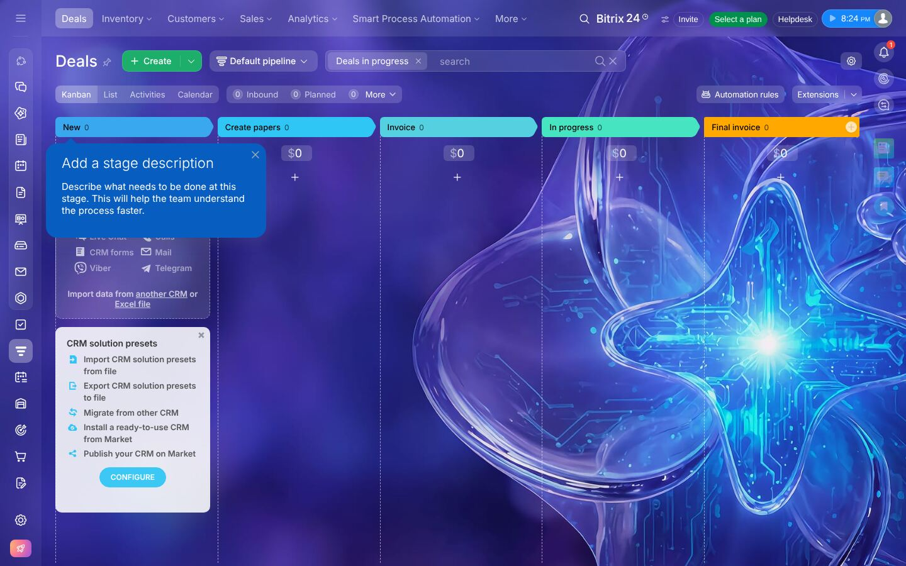
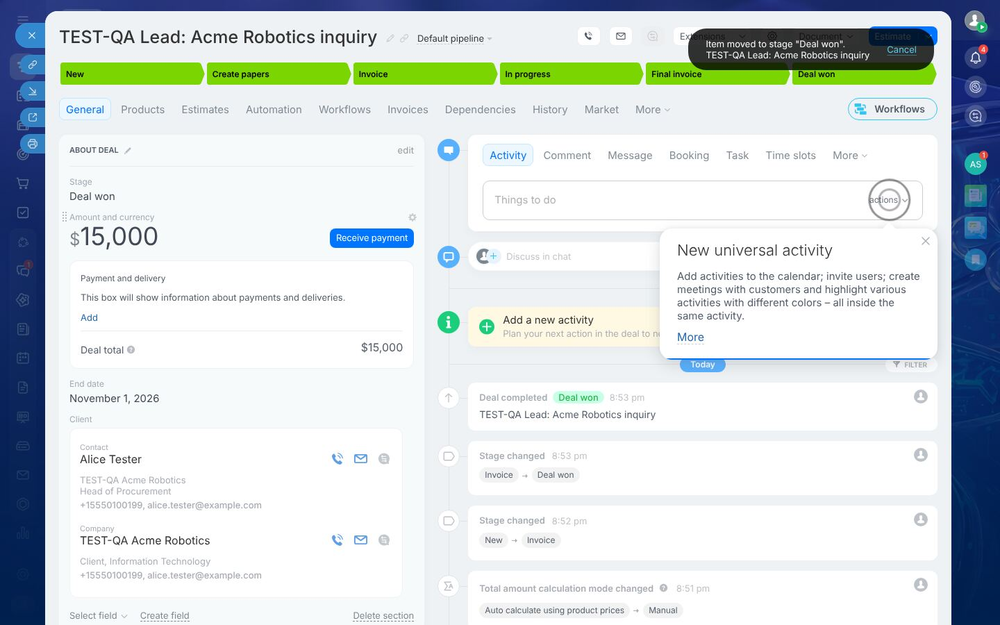
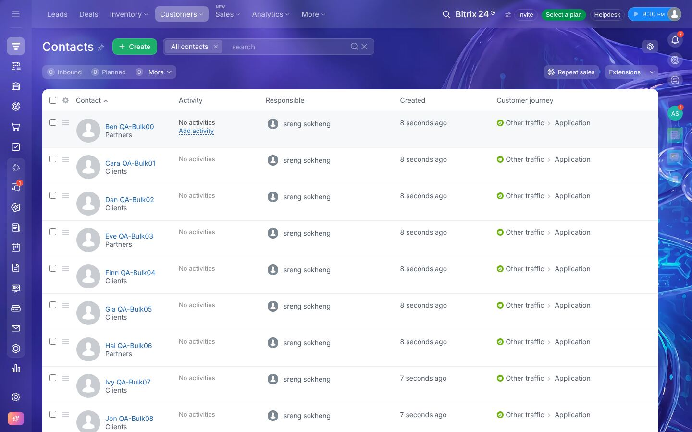
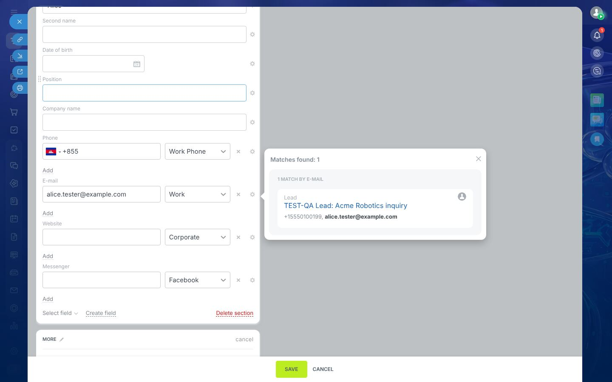
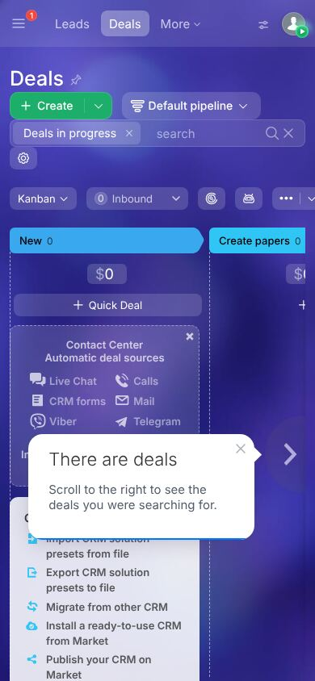

# UX Redesign — Problems Found in Bitrix24 and Our Proposal

Goal: keep Bitrix24's **CRM power** (pipelines, conversion, timeline, automation, permissions)
while making the product calm, obvious and fast for a first-time user.

Design principles:

1. **One way to navigate.** A single labelled sidebar. No icon rails, no top mega-menus.
2. **The record is the workspace.** Everything about a customer is on one page: key facts, what's
   next, and what happened.
3. **Progressive disclosure.** Ordinary users see the 20 % they use daily; admins find the rest
   in Settings, not sprinkled through every form.
4. **Show the numbers.** Totals, counts and sums are always visible — never behind "show quantity".
5. **Honest defaults.** Never silently fill business data (source "Call", industry "IT").
6. **Forgiving.** Undo for destructive or big actions; restore keeps identity.
7. **Quiet chrome.** No wallpapers, no upsell, no onboarding popovers that block the work.

---

## 1. Problems observed (with evidence)

| # | Problem | Evidence | Impact |
|---|---|---|---|
| P1 | **Four navigation surfaces** (left icon rail, top menu with 8 dropdowns, right rail, in-page view bar). Icons unlabeled; CRM mixed with intranet tools (Feed, Drive, Sites, Store). |  | Users can't build a mental map; "where is X?" |
| P2 | **Upsell & onboarding noise**: "Select a plan", "Upgrade your plan", promo banners, *Contact Center* and *CRM solution presets* cards occupying the first Kanban column, "Add a stage description" and "New universal activity" popovers re-appearing on every open. | 01, 07, 58, 106 | Blocks content, erodes trust |
| P3 | **Low contrast** — busy 3D wallpaper behind glassy panels; light-on-purple text. | 01, 56 | Readability, accessibility (WCAG) |
| P4 | **Tab overload on records**: General, Products, Estimates, Automation, Workflows, Invoices, Dependencies, History, Market, More (+ header: Extensions, Document, gear, split button). Timeline composer has 8+ tabs (Activity, Comment, Message, Booking, Task, Time slots, Invite to chat, E-mail, Zoom, More). |  | Choice paralysis; important things hidden |
| P5 | **Admin controls in user forms**: every section shows *Select field · Create field · Delete section* to normal users. | 35, 95 | Accidental schema changes; clutter |
| P6 | **Typography & casing inconsistency**: SAVE/CANCEL uppercase, "Save" sentence case elsewhere, ALL-CAPS section titles, mixed button styles (lime, blue, outlined, link). | 32, 53, 71 | Feels assembled from different products |
| P7 | **Hidden totals**: lists show "Total: Show quantity"; Kanban sums exist but list sums don't. |  | Users can't answer "how many / how much?" |
| P8 | **Silent defaults**: empty lead saved as "Lead #1" with source *Call*; company auto-tagged *Client, IT, <50 employees* on conversion. | 33, 96 | Polluted data & reports |
| P9 | **No validation guidance**: lead form has no required fields and no hint what makes a good lead. | 33 | Junk records |
| P10 | **Duplicates warn but can't be resolved in place** (no merge, no "use existing"). |  | Duplicates accumulate |
| P11 | **Inconsistent product totals** (rows $15,000, total $0) and catalog errors surfaced as technical messages ("Incorrect information block code"). | 49, 52 | Lost trust in numbers |
| P12 | **Restore changes record ID** (5 → 7). | 87 | Broken links & integrations |
| P13 | **Required fields enforced only in UI**; API bypasses them. | Workflow §5.5 | Data quality depends on the client |
| P14 | **Simple vs Classic mode** is a modal ambush when you click Leads. | 30 | Confusing first experience |
| P15 | **Analytics menu of 18 items, most locked** behind BI Builder. | 62 | Frustration; no usable dashboard on free tier |
| P16 | **Automation designer** is powerful but dense; rule text like "3 days, after previous · Control · To supervisor" is cryptic. | 67 | Hard to understand what will happen |
| P17 | **Mobile web** is a shrunk desktop: horizontal Kanban, popovers covering cards, 4 rails. |  | Unusable on phones |
| P18 | **Permissions matrix** is a very wide grid with truncated labels ("Items of their … and 1 more"). | 93 | Admins can't verify who sees what |

### What Bitrix24 does well (keep it)

- **Stage bar** on the record — clickable, colored, turns green/red on close.
- **Kanban column sums** and quick-add at the top of a column.
- **Required-field mini-form on drag** — asks only for the missing fields.
- **Won / Lost close dialog** with failure reasons.
- **Undo toast** after stage change.
- **Unified timeline** with pinned "Things to do" above history.
- **One-click conversion** with sensible combinations.
- **Activity linked to many records** — the contact page becomes a true customer history.
- **Field-level history** (old → new).
- **Real-time duplicate hint** while typing.
- **Per-stage automation board** — the mental model "when a deal enters this stage, do X" is right.

---

## 2. Information architecture

```
┌──────────────────────┐
│  ◆ Acme CRM        ▾ │  workspace switcher (later)
│  🔍 Search…     ⌘K   │
├──────────────────────┤
│  🏠 Home             │  dashboard + my day
│  ✓  Activities   (3) │  my to-dos, calls, meetings (badge = overdue)
├──────────────────────┤
│  ⚡ Leads            │  (hidden if "Use leads" is off)
│  💼 Deals            │
│  👤 Contacts         │
│  🏢 Companies        │
│  📦 Products         │
├──────────────────────┤
│  📊 Reports          │
├──────────────────────┤
│  ⚙  Settings         │  admin-only sections are badge-locked for others
│  [avatar] Sreng  ▾   │  profile, theme, sign out
└──────────────────────┘
```

- Sidebar collapses to icons (with tooltips) on tablets; becomes a bottom tab bar
  (Home, Deals, Contacts, Activities, More) on phones.
- **Settings** contains: Workspace, Users & teams, Roles & permissions, Pipelines & stages,
  Fields, Dictionaries (sources, lost reasons, types), Products settings (taxes, units),
  Automation, Recycle bin, Audit log.

## 3. Key screens

### 3.1 Home (dashboard)

```
Good morning, Sreng                                   [ + New ▾ ]
┌─────────────┬─────────────┬─────────────┬─────────────┐
│ Open pipeline│ Won this mo.│ Win rate    │ Overdue     │
│ $42,500  ▲8% │ $15,000     │ 50 %        │ 3 activities│
└─────────────┴─────────────┴─────────────┴─────────────┘
┌──────────────────────────────┐ ┌────────────────────────┐
│ Pipeline by stage  [Sales ▾] │ │ My day                 │
│ New        ████████  $12k (4)│ │ ☐ 09:00 Call Alice     │
│ Proposal   █████     $8k  (2)│ │ ☐ 11:30 Demo – Globex  │
│ Negotiation██        $3k  (1)│ │ ⚠ Overdue: Send quote  │
└──────────────────────────────┘ └────────────────────────┘
┌──────────────────────────────┐ ┌────────────────────────┐
│ Won vs lost – last 6 months  │ │ Recent activity        │
│ (bar chart)                  │ │ Deal won · Acme · 2h   │
└──────────────────────────────┘ └────────────────────────┘
```

Scope toggle on dashboard: *Me / My team / Everyone* (respects permissions).

### 3.2 Deals — Kanban

```
Deals  [Sales pipeline ▾]   🔍 Search   [Filters ▾] [Owner: Me ▾]     [Board|List]  [+ Deal]
┌ New · 4 · $12,000 ┐┌ Qualified · 2 · $8,000 ┐┌ Proposal · 1 · $3,000 ┐┌ …
│ + Quick add       ││                         ││                       │
│ ┌───────────────┐ ││ ┌─────────────────────┐ ││                       │
│ │Acme robotics  │ ││ │Globex renewal       │ ││                       │
│ │$15,000 · Alice│ ││ │$5,000 · Globex Ltd  │ ││                       │
│ │⏰ Call tomorrow│ ││ │⚠ No next step       │ ││                       │
│ │           (SS)│ ││ │                 (SS)│ ││                       │
│ └───────────────┘ ││ └─────────────────────┘ ││                       │
└───────────────────┘└─────────────────────────┘└───────────────────────┘
          While dragging:  [   🏆 Won   ]   [   ✗ Lost   ]  drop zones appear at the bottom
```

- Card = title, amount, primary contact/company, **next activity** (or "No next step" warning),
  owner avatar, idle badge if stuck > N days.
- Column header = name, count, sum (weighted sum on hover).
- Drag → server validates → mini-form for missing required fields → undo toast.
- Drop on **Lost** → reason picker. Drop on **Won** → confetti-free success toast.
- Horizontal scroll with snap; on phones, the board becomes a **stage selector + vertical list**.

### 3.3 Lists (all entities)

```
Contacts                                                           [Import] [+ Contact]
[All contacts] [My contacts] [Added this week] [+ Save view]
🔍 Search name, email, phone…    [Type: Client ✕] [Owner: Me ✕] [+ Filter]    ⚙ Columns
┌──┬──────────────────┬────────────────┬──────────────┬──────────┬──────────┐
│☐ │ Name ↑           │ Company        │ Email        │ Owner    │ Created  │
├──┼──────────────────┼────────────────┼──────────────┼──────────┼──────────┤
│☐ │ Alice Tester     │ Acme Robotics  │ alice@…      │ Sreng    │ Today    │
└──┴──────────────────┴────────────────┴──────────────┴──────────┴──────────┘
128 contacts · Showing 1–25        ‹ 1 2 3 4 5 6 › 25 / page ▾
With selection:  [Assign] [Edit field] [Export] [Delete]
```

Deals list also shows a **sum row** of amounts for the current filter.

### 3.4 Record page (deal shown; lead/contact/company share the layout)

```
← Deals   Acme Robotics inquiry  ✎                     [ Won ] [ Lost ] [ ⋯ ]
          $15,000 · Sales pipeline · Owner Sreng · Close Nov 8
[ New ▸ Qualified ▸ Proposal ▸ Negotiation ▸ ✓ ]   ← clickable stage bar
┌──────────────── Details ─────────────────┐ ┌──────────── Timeline ─────────────────┐
│ Amount        $15,000 (auto from items)  │ │ [ Note ] [ Activity ] [ Log call ]     │
│ Expected close Nov 8, 2026               │ │ ┌──────────────────────────────────┐   │
│ Probability   40 %                       │ │ │ Write a note…                    │   │
│ Source        Website                    │ │ └──────────────────────────────────┘   │
│ Segment*      — required from Proposal   │ │ UP NEXT                                │
│ ▸ More fields (6)                        │ │ ☐ Call Alice · Wed 9:00 · Sreng        │
├──────────────── People ──────────────────┤ │ HISTORY                                │
│ 👤 Alice Tester · Head of Procurement     │ │ • Stage New → Proposal · 2h · Sreng    │
│    ☎ +1 555 010 0199  ✉ alice@example.com│ │ • Note: Asked for 3 arms · 3h          │
│ 🏢 Acme Robotics                          │ │ • Created from lead · yesterday       │
├──────────────── Products (2) ────────────┤ │                    [All ▾ filter]     │
│ Robotic Arm X1   3 × 4,500   13,500      │ └────────────────────────────────────────┘
│ Installation     1 × 1,500 −10%  1,350   │
│                          Total 14,850    │
└──────────────────────────────────────────┘
Tabs (only when needed): Overview · Products · History
```

- Fields are **inline-editable** (click → edit → Enter saves); empty fields collapse into
  "More fields (n)". No per-section "edit" modes.
- Required-by-stage fields show a hint ("required from Proposal") before they block.
- Composer has **3 tabs**: Note, Activity (task/call/meeting/deadline with type chips), Log call.
- Lead record replaces Won/Lost with **[ Convert ]** and **[ Disqualify ]**.
- On phones: header + stage selector, then segmented control *Details / Timeline*.

### 3.5 Convert lead dialog

```
Convert "Acme Robotics inquiry"
☑ Create contact   Alice Tester           ⚠ Similar: Alice Tester (contact #12)  [Use existing]
☑ Create company   Acme Robotics          ✓ No duplicates
☑ Create deal      Pipeline [Sales ▾]  Stage [New ▾]  Amount [$15,000]
   Required for deal:  Segment [ SMB ▾ ]
                                                     [Cancel]  [Convert]
```

One screen replaces the 8-option dropdown; duplicates are resolved inline.

### 3.6 Settings → Pipelines

Horizontal stage chips per pipeline (like Bitrix24's "Sales pipelines and tunnels", which is
good) with drag-reorder, color, type (open/won/lost), probability, and **"Automations (3)"**
link per stage.

### 3.7 Settings → Automation (per pipeline)

```
Sales pipeline ▾                                                    [+ Add rule]
When a deal enters  NEW
   ① Immediately → Create activity "Call the customer" for Owner, due in 1 day
   ② After 3 days if still in this stage → Notify Owner's manager
When a deal enters  PROPOSAL
   ① Immediately → Add note "Send proposal within 24h"
[Run log]
```

Plain-English sentences instead of cryptic cards; each rule editable in a side drawer.

### 3.8 Settings → Roles & permissions

One role per page (not a giant matrix):

```
Role: Sales rep                                         [Duplicate] [Delete]
            View        Create   Edit        Delete     Export
Leads       Own+Team ▾  ✓        Own ▾       None ▾     ✗
Deals       Team ▾      ✓        Own ▾       None ▾     ✗
Contacts    All ▾       ✓        Team ▾      None ▾     ✓
Members: Sreng, Dara, +3                                [Manage]
```

## 4. Visual system

| Token | Value |
|---|---|
| Font | **Inter** (UI), tabular numbers for amounts; JetBrains Mono for IDs/code only |
| Type scale | 12 / 13 / 14 (body) / 16 / 20 / 24 / 30 px; weights 400/500/600 |
| Spacing | 4-px grid: 4, 8, 12, 16, 20, 24, 32, 40, 48 |
| Radius | 6 px controls, 10 px cards, 14 px dialogs |
| Neutrals | zinc/slate scale; page `#F8FAFC` (light) / `#0B0F17` (dark) |
| Accent | one brand color (indigo-600) for primary actions & focus |
| Semantic | success emerald, danger rose, warning amber, info sky |
| Stage colors | user-picked from a fixed accessible palette of 12 |
| Elevation | 2 levels: card (subtle border), overlay (shadow + border) |
| Icons | **Lucide**, 16/20 px, 1.75 stroke |
| Motion | 150–200 ms ease-out; no decorative animation |
| Casing | Sentence case everywhere; no ALL-CAPS buttons |

Components (built once, reused): Button (primary/secondary/ghost/danger), Input, Select, Combobox
(search + create), DatePicker, MoneyInput, Badge, Avatar, Tabs, Drawer, Dialog, Toast (with undo),
DataTable, KanbanBoard, StageBar, EmptyState, Skeleton, Timeline, FilterChips, CommandPalette.

## 5. Interaction rules

- Primary action per screen = one filled button (top right). Secondary actions in "⋯".
- Destructive actions: confirm dialog **or** undo toast (prefer undo for single items).
- Every list and board has: loading skeleton, empty state with a single CTA, error state with retry.
- Forms validate on blur and on submit; server errors map to fields.
- Keyboard: `⌘K` search, `N` new record in context, `E` edit, `Esc` close drawer, `/` focus search.
- Accessibility: WCAG 2.1 AA contrast, focus rings, ARIA for Kanban drag (keyboard move with
  arrow keys), labelled icons.

## 6. How each problem is addressed

| Problem | Fix |
|---|---|
| P1 | Single labelled sidebar; CRM only |
| P2 | No upsell; onboarding = one dismissible checklist on Home, never over content |
| P3 | Solid backgrounds, AA contrast, dark mode via tokens |
| P4 | Max 3 tabs per record; composer with 3 tabs; related records in the left column |
| P5 | Field management only in Settings → Fields (admin) |
| P6 | Design tokens + component library, sentence case |
| P7 | Count + sum always shown in lists and boards |
| P8 | No silent business defaults; title auto-generated from data |
| P9 | "At least one of" validation for leads; required/required-from-stage fields shown upfront |
| P10 | Duplicate hint with "Use existing" (forms) and Merge (v1.1) |
| P11 | Decimal-safe line math on the server; friendly error messages |
| P12 | Soft delete; restore keeps the ID |
| P13 | All validation on the server; UI mirrors it |
| P14 | "Use leads" toggle in Settings with explanation |
| P15 | Free, built-in dashboard + 8 core reports |
| P16 | Sentence-style automation editor |
| P17 | Mobile layouts designed explicitly (bottom tabs, stage selector, details/timeline toggle) |
| P18 | One-role-per-page editor, scopes as plain dropdowns |
