# CRM Workflows — Tested in Bitrix24

This is a step-by-step log of the real workflows we ran in the reference portal on 1 Nov 2026,
what Bitrix24 did at each step, and the **business rule** we derive for our own CRM.

Legend: ✅ tested & worked · ⚠️ tested, problematic/partial · ❌ blocked · 📌 rule for our CRM

All test data is prefixed `TEST-QA` and uses `example.com` addresses / `555` phone numbers, so
no real person was contacted.

---

## 0. Preparation

| # | Step | Result |
|---|---|---|
| 0.1 | Sign in with the owner's session. | ✅ Portal on free plan, one user. |
| 0.2 | Open *Leads*. | ✅ Modal "Choose the way you want to work with your CRM" (Simple vs Classic). |
| 0.3 | Choose **Classic CRM**, Save. | ✅ Mode switched; leads enabled. |

📌 Leads are optional. Workspace setting **"Use leads"** (default on). When off, inbound items
create deals directly and the Leads module is hidden.

---

## 1. Create a lead

| # | Step | Result |
|---|---|---|
| 1.1 | *Create* → new lead form (slider). | ✅ Form with stage bar, sections *Lead information*, *More*, *Products*; timeline on the right ("You are now adding a lead…"). 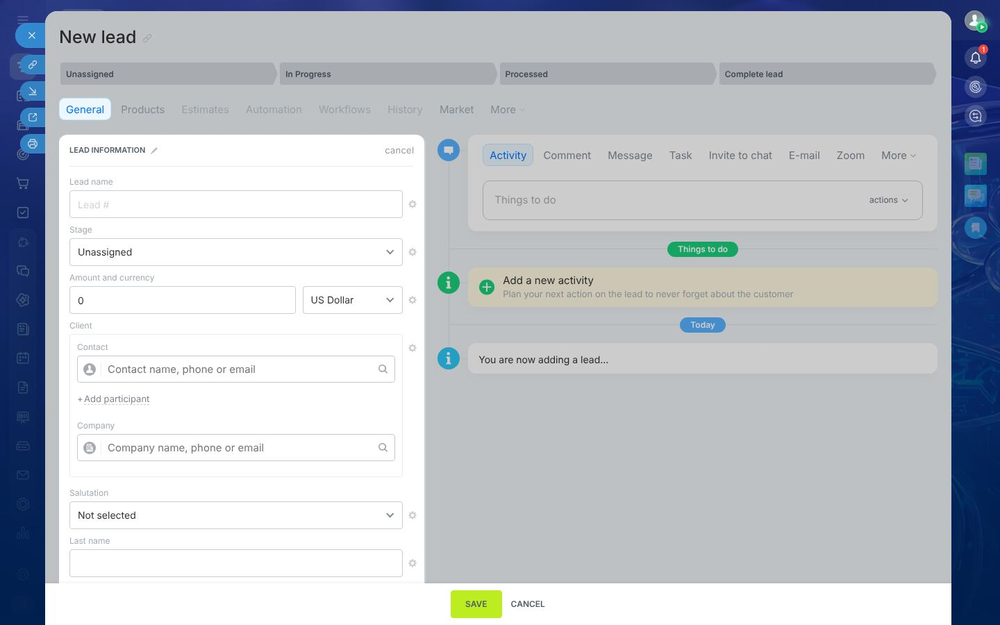 |
| 1.2 | **Save the empty form** (validation test). | ⚠️ Saved without complaint as **`Lead #1`**, source = *Call*, stage = *Unassigned*, responsible = me, visible to everyone. 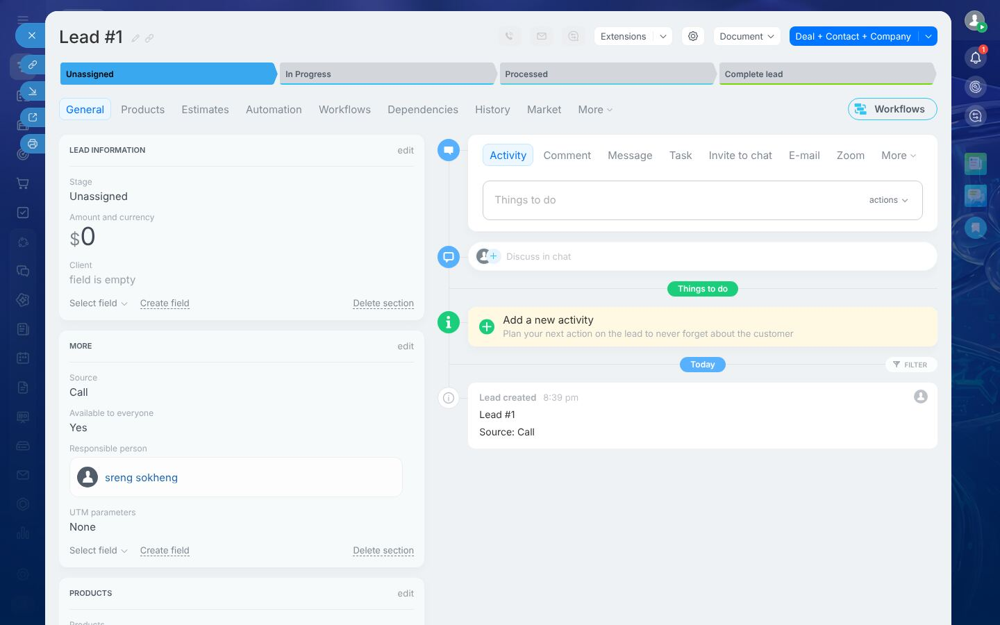 |
| 1.3 | Fill title, first/last name, position, company name, phone, email, source info; Save. | ✅ Lead #3 created. View mode hides empty fields. Phone stored in E.164 (`+15550100199`), labelled *Work Phone*. 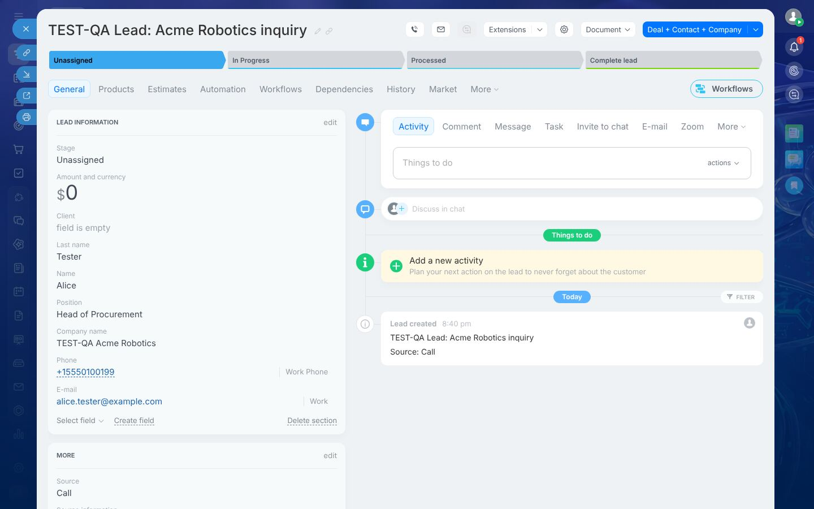 |

Observations:
- IDs jumped 1 → 3 (cloud sharding); irrelevant for us.
- Our amount input was not applied (we typed into the wrong control — the amount field is
  visually adjacent to a hidden input). Minor, but shows the form's fragility.

📌 A lead needs **at least one of**: title, person name, company name, phone, email.
If no title is given, generate one from *company name → person name → "New lead"*.
📌 Do **not** silently default *Source* to "Call"; leave it empty unless set by the channel.

---

## 2. Work the lead: note, activity, stage, duplicates

| # | Step | Result |
|---|---|---|
| 2.1 | Timeline → *Comment* → "QA note: Alice asked for a quote…" → Send. | ✅ Comment card with Pin, edit, copy. |
| 2.2 | Timeline → *Activity* → type "QA follow-up: call Alice…". | ✅ To-do editor pre-fills title **"Contact customer"**, deadline **Wed 4 Nov 09:00** (≈3 days), color, responsible, reminder bell, *actions* menu (calendar, customer, invite, address, location, link, file). 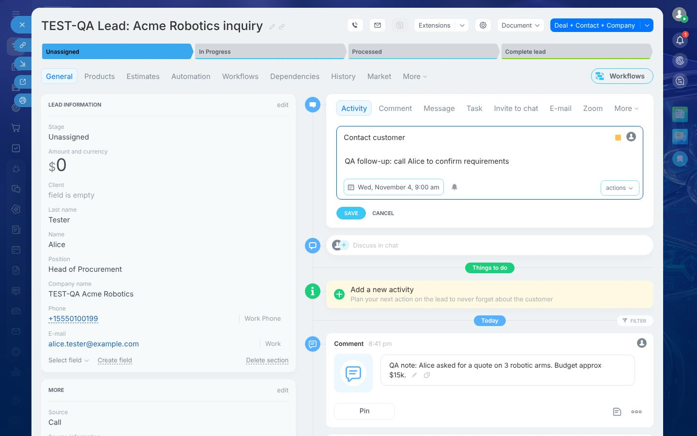 |
| 2.3 | Save the activity. | ✅ Appears under **"Things to do"** at the top of the timeline with *Completed* / *Edit*, and a log entry below. 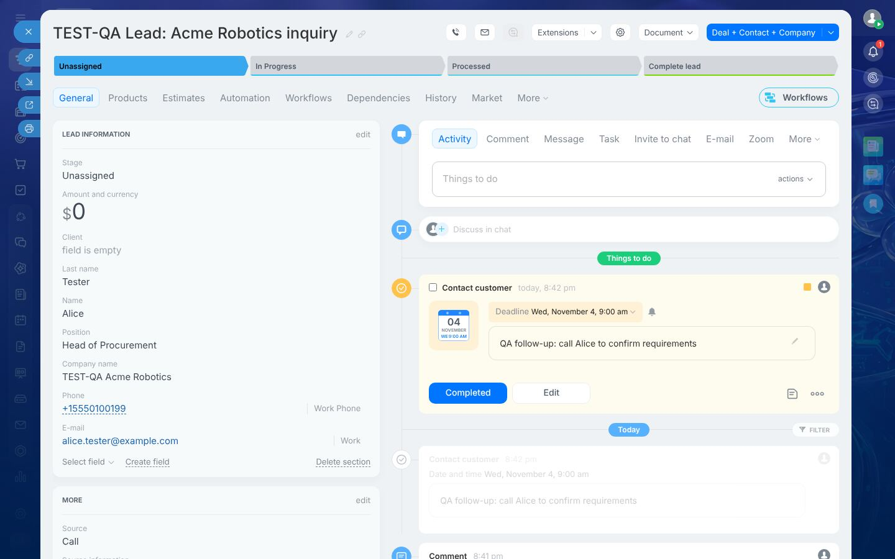 |
| 2.4 | Click *In Progress* on the stage bar. | ✅ `STATUS_ID = IN_PROCESS`; one click, no confirmation; logged. |
| 2.5 | Create a 2nd lead and type the **same email**. | ✅ Popup **"Matches found: 1 — 1 match by e-mail"** with a link to the existing lead. 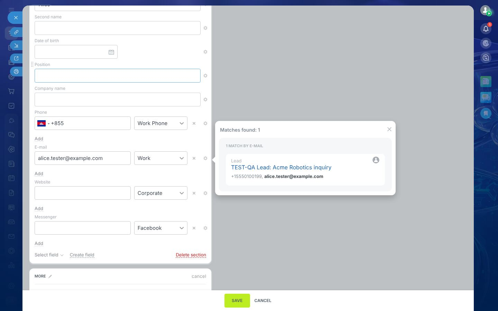 |
| 2.6 | Save the duplicate anyway. | ✅ Saved as Lead #5 — **warning only, not blocking**. |

📌 Timeline = pinned "Up next" (open activities sorted by due date) + chronological feed.
📌 Duplicate check runs on normalised email/phone (and company name) across leads, contacts and
companies, while typing; it warns and offers **"Open existing" / "Merge" / "Save anyway"**.

---

## 3. Convert lead into deal + contact + company

| # | Step | Result |
|---|---|---|
| 3.1 | Open the conversion dropdown on the lead header. | ✅ Options: *Deal + Contact + Company, Deal + Contact, Deal + Company, Deal, Contact + Company, Contact, Company, Select from list…* 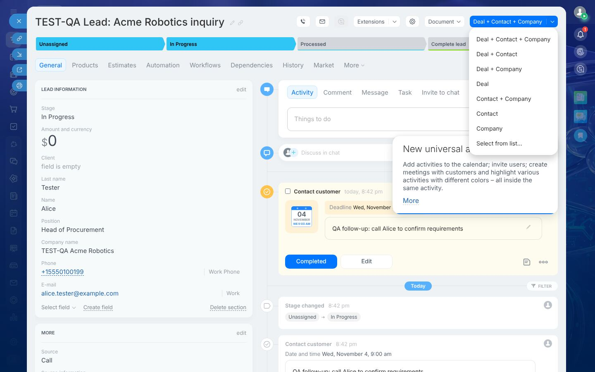 |
| 3.2 | Click **Deal + Contact + Company**. | ✅ No dialog (no required fields). Deal #1, Contact #1, Company #1 created; deal opened. 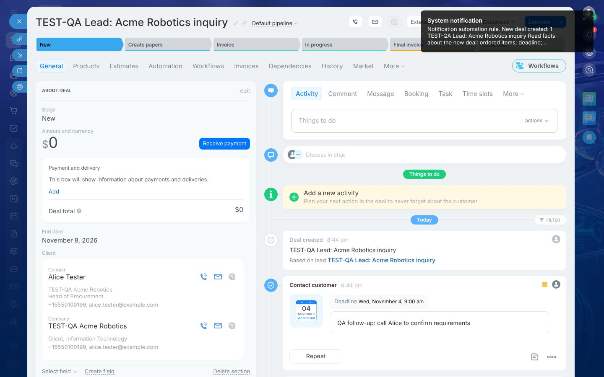 |

What was copied / set (verified via API):

| Target | Values |
|---|---|
| Lead | `STATUS_ID = CONVERTED` (success), `CONTACT_ID = 1`, `COMPANY_ID = 1` |
| Deal | title = lead title, pipeline = default, stage = *New*, type = *Sales*, source = lead source, `LEAD_ID = 3`, contact + company linked, **close date = today + 7**, amount = lead amount |
| Contact | first/last name, position, phone, email, source, `TYPE = Clients`, linked to company, `LEAD_ID = 3` |
| Company | title = lead "company name", phone, email copied, **type = Client, industry = IT, employees < 50 (silent defaults)**, `LEAD_ID = 3` |
| Activity | the lead's open to-do was **re-bound to lead + deal + contact + company** and **marked completed** |
| Automation | default rule fired: system notification "New deal created …" |
| Timeline | deal: "Deal created — based on lead …"; contact/company: "Created — based on lead …" |

📌 Conversion is a **single transaction** that: (1) creates/links contact (reuse if duplicate
found), (2) creates/links company (reuse if found), (3) creates deal in the chosen pipeline,
(4) copies product rows and custom fields with matching keys, (5) re-links notes & activities to
the new records, (6) marks the lead converted and stores the three target IDs, (7) writes audit
events. If target required fields are missing, show a **compact form for just those fields**.
📌 Do **not** auto-complete the lead's open activities; move them to the deal (they're still
real to-dos). Don't invent industry/size defaults.

---

## 4. Add products to the deal

| # | Step | Result |
|---|---|---|
| 4.1 | Deal → *Products* tab. | ✅ Grid: product search ("Find or create a new product"), image, Price, Quantity (pcs.), Amount; summary block. 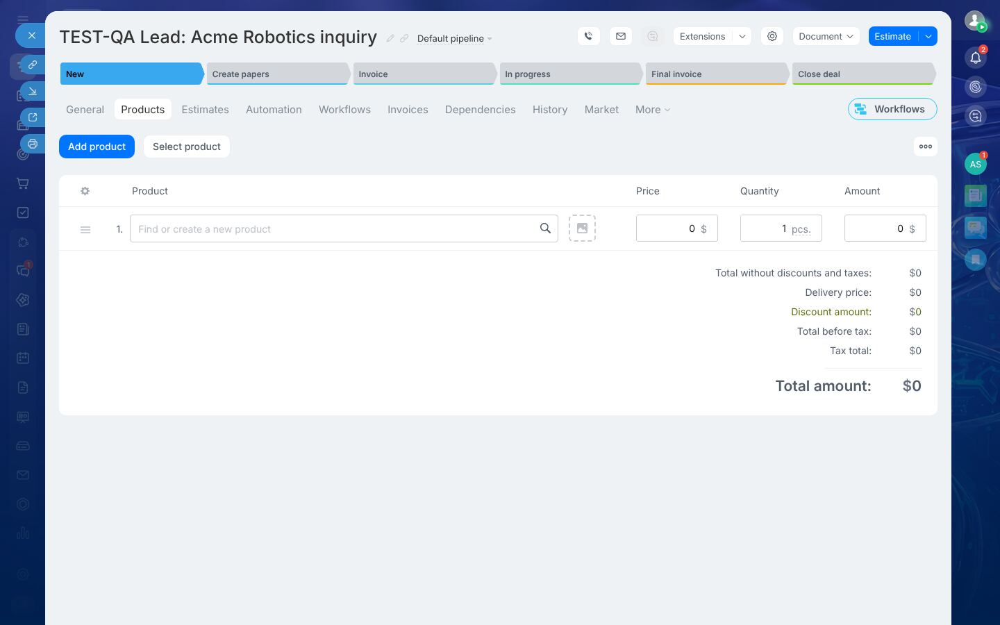 |
| 4.2 | Type "TEST-QA Robotic Arm X1" → *Create:* (Ctrl+Enter). | ❌ Toast **"Incorrect information block code."** — product catalog not provisioned on this portal. 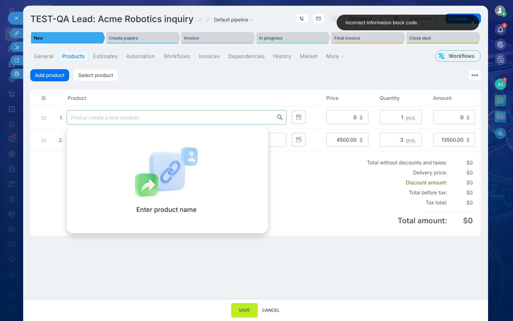 |
| 4.3 | Catalog pages (`/crm/catalog/`, Inventory → Products). | ❌ "Cannot find the specified information block." |
| 4.4 | Via API: 2 free-text rows — Arm X1 4,500 × 3; Installation 1,500 × 1 with 10 % discount. | ✅ Rows saved. Discount stored as `DISCOUNT_SUM 166.67` (price field = post-discount price; list price shown 1,666.67). |
| 4.5 | Re-open Products tab. | ⚠️ Rows show amounts 13,500 + 1,500 but **Total amount $0** — inconsistent summary. 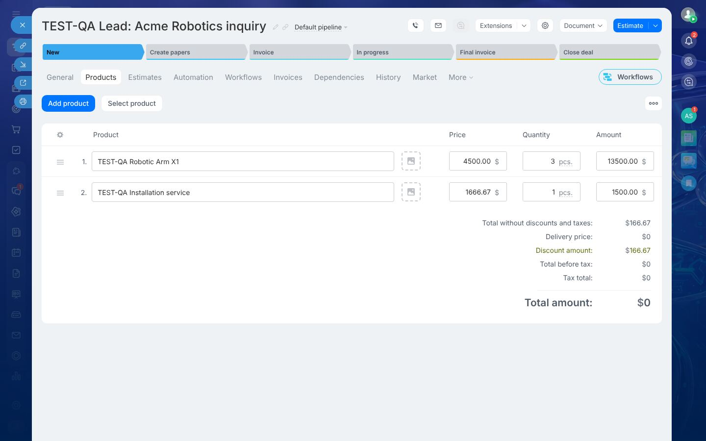 |
| 4.6 | Set deal amount manually to 15,000. | ✅ Timeline: "Total amount calculation mode changed: Auto calculate using product prices → Manual". |

📌 Deal amount has two modes: **auto** (sum of line totals) or **manual** override (with a
visible badge "manual"). Line math (all in minor units, decimal-safe):
`list_total = unit_price × qty` → `discount = percent ? list_total × p% : fixed` →
`net = list_total − discount` → `tax = tax_included ? net − net/(1+r) : net × r` →
`line_total = tax_included ? net : net + tax`. Deal: Σ line_total (+ delivery if used).
📌 Product rows snapshot name, price and tax at the time they're added (catalog edits don't
rewrite history). Free-text rows (no catalog product) are allowed.

---

## 5. Move the deal through stages

| # | Step | Result |
|---|---|---|
| 5.1 | Kanban → *Quick Deal* → "TEST-QA Quick deal (to be lost)", $2,500 → Save. | ✅ Card appears at top of *New*; column total updates. 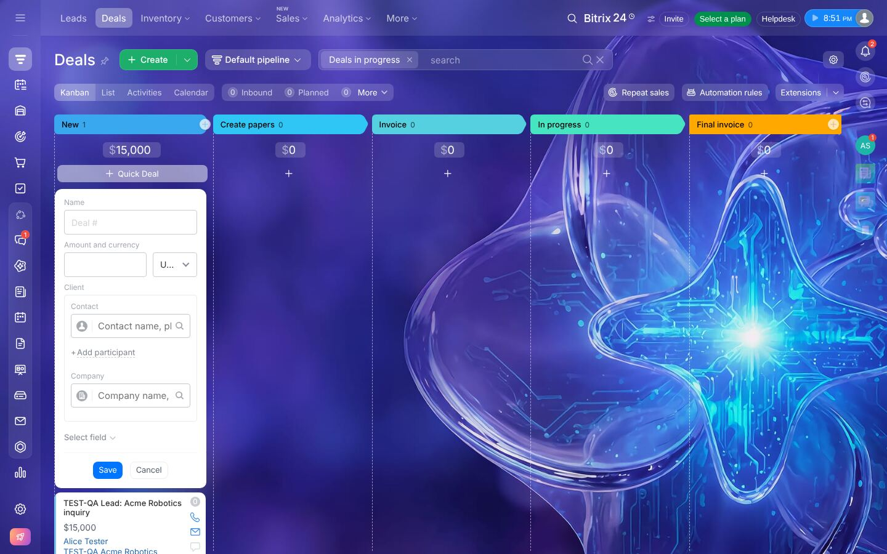 |
| 5.2 | Drag deal #1 from *New* to *Invoice*. | ✅ `STAGE_ID = PREPAYMENT_INVOICE`; totals: New $2,500, Invoice $15,000. Automation notification "Congratulations! … At this stage you need to …". 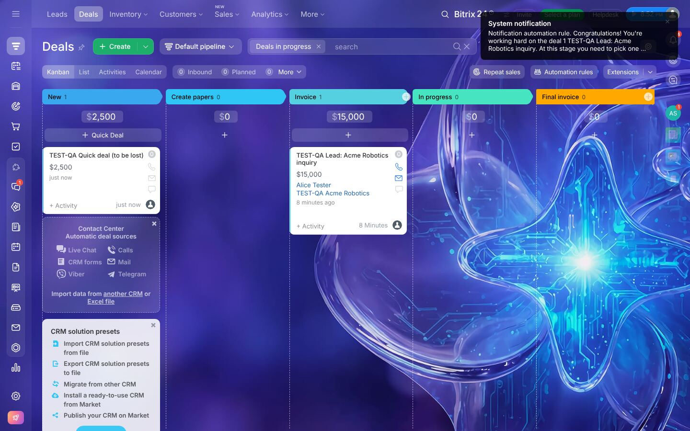 |
| 5.3 | Add required list field *QA Customer segment*; drag another deal forward. | ✅ Drop intercepted: **"Please complete the required fields to change the stage"** with only that field. 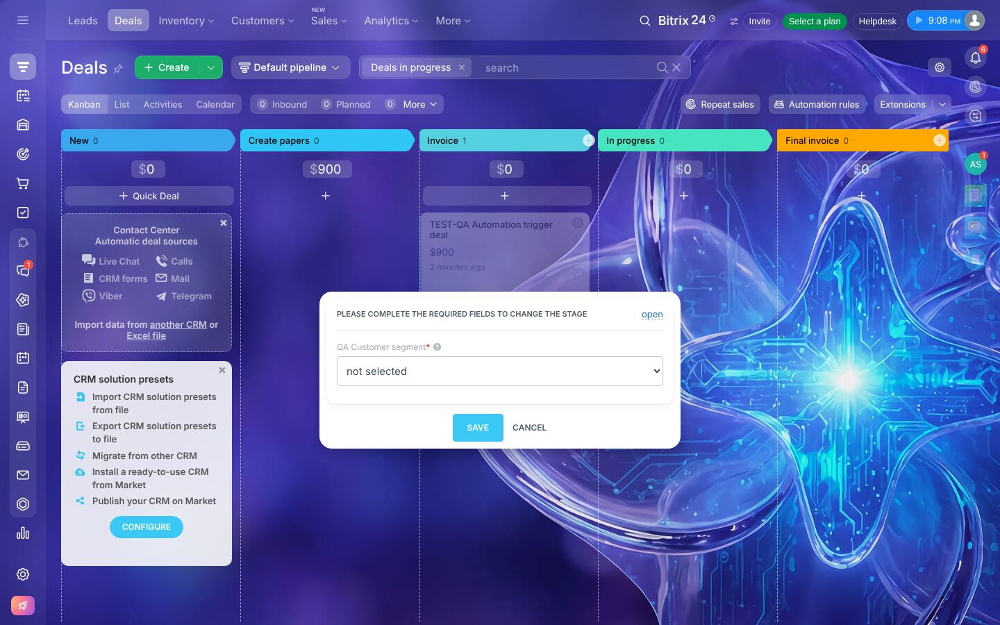 |
| 5.4 | Choose "SMB", Save. | ✅ Stage changed and field saved in one step. |
| 5.5 | Same stage move through the REST API with the field empty. | ⚠️ **Allowed** — required fields are UI-only in Bitrix24. |

📌 Stage changes are validated **on the server** (required-by-stage fields, permission
"move to stage"), and the UI asks only for what's missing.
📌 Every stage change records `previous_stage`, `moved_by`, `moved_at`, writes an audit event and
triggers automation.

---

## 6. Notes, activities and follow-up tasks on the deal

| # | Step | Result |
|---|---|---|
| 6.1 | Deal timeline → *Task* → full task form (slider). | ✅ Prefilled: title "CRM: {deal title}", owner & assignee = me, **deadline ≈ +1 week 19:00**, CRM item = the deal, tag `crm`; many optional blocks (checklist, observers, project, sub-tasks, time tracking…). 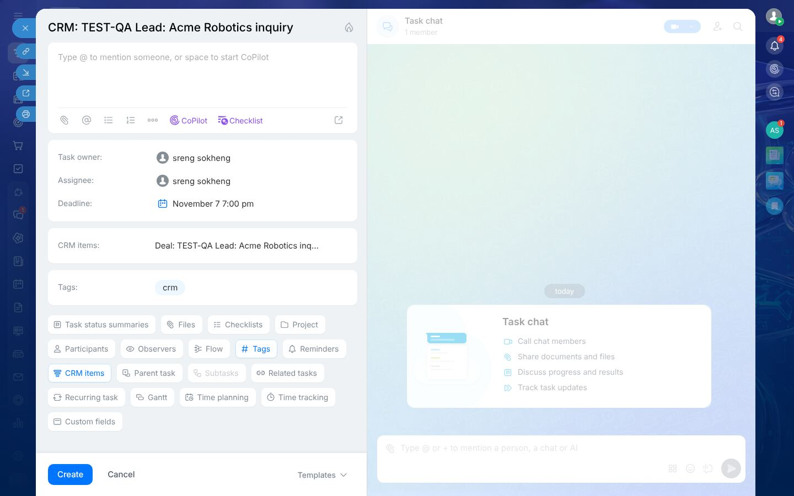 |
| 6.2 | Enter title, *Create*. | ✅ Task #1 created, linked `UF_CRM_TASK = ["D_1"]`; shows in deal timeline ("Things to do"), *My tasks* and *My activities*. ⚠️ The prefilled "CRM: …" prefix got concatenated with our title. |

📌 One "Activity" concept with kinds **Task, Call, Meeting, Email (logged), Deadline**, each with
due date/time, assignee, priority, reminder, and links to many records. A separate lightweight
**Note** for free text. No separate Tasks module needed for CRM v1.

---

## 7. Win and lose deals

| # | Step | Result |
|---|---|---|
| 7.1 | Deal #1 → click final segment *Close deal*. | ✅ "Finalize … select the processing result: **Deal won / Failure**". 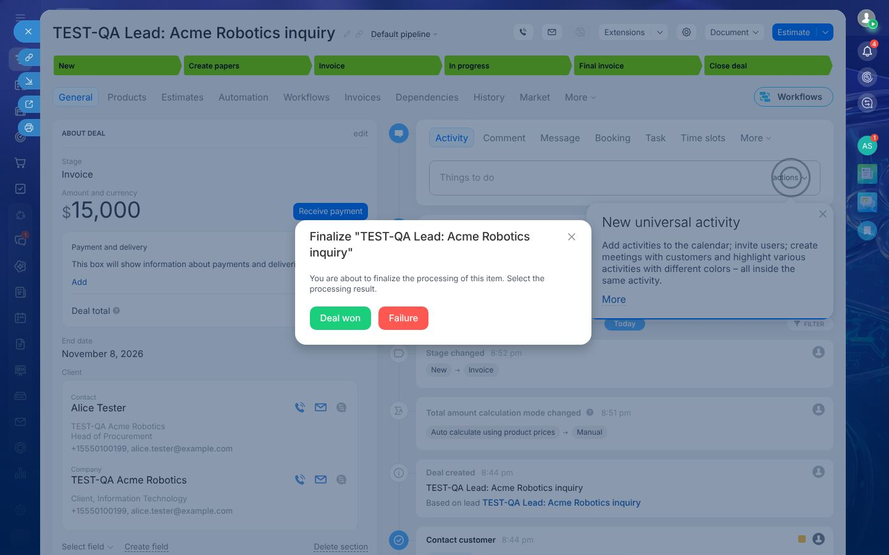 |
| 7.2 | *Deal won*. | ✅ All segments green, `STAGE=WON`, `CLOSED=Y`, **close date changed to today**, undo toast "Cancel". 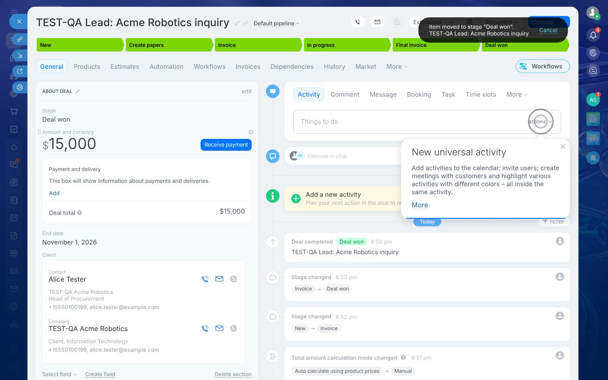 |
| 7.3 | Deal #3 → *Close deal* → *Failure*. | ✅ Second step: **Deal lost / Analyze failure**. 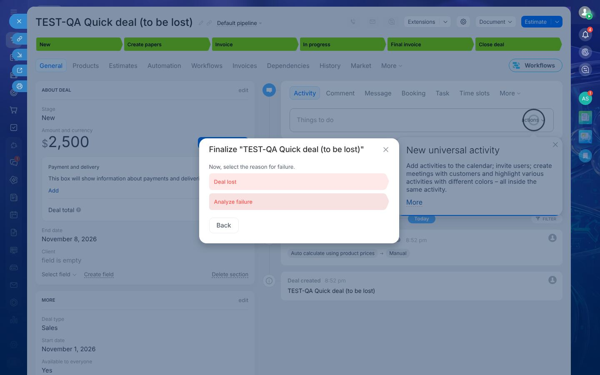 |
| 7.4 | *Analyze failure*. | ✅ All segments red, `STAGE=APOLOGY`, semantic F, closed. 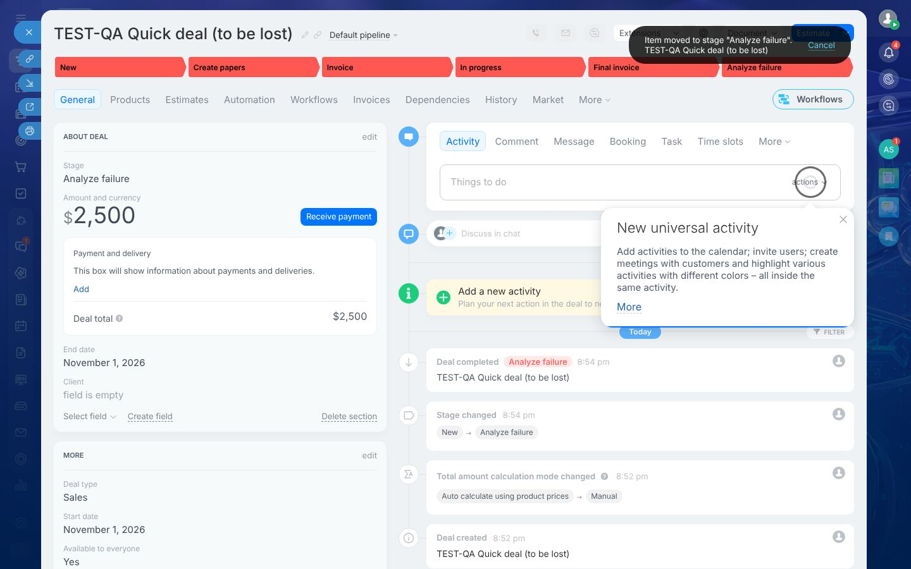 |

📌 Won/Lost are explicit actions (buttons in the header, and drop zones on the Kanban), not just
"stages". Lost requires a **reason** (configurable list) and optional comment. Closing sets
`closed_at` (does **not** overwrite the expected close date — keep both). Re-opening is allowed
and audited. Undo toast for 5 s.

---

## 8. How reports reflect the changes

| Report | Output after our test | Status |
|---|---|---|
| Won deals | 1 row: TEST-QA Lead: Acme Robotics inquiry, Sales, Client, Tester, **15,000**, 11/01/2026 | ✅ 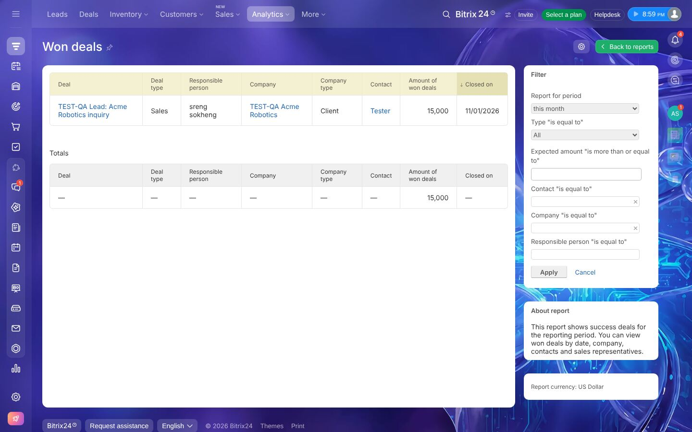 |
| Deals by stage | Deal won 1 (50 %, 15,000), Analyze failure 1 (50 %, 2,500); totals 2 / 17,500 / 15,000 | ✅ 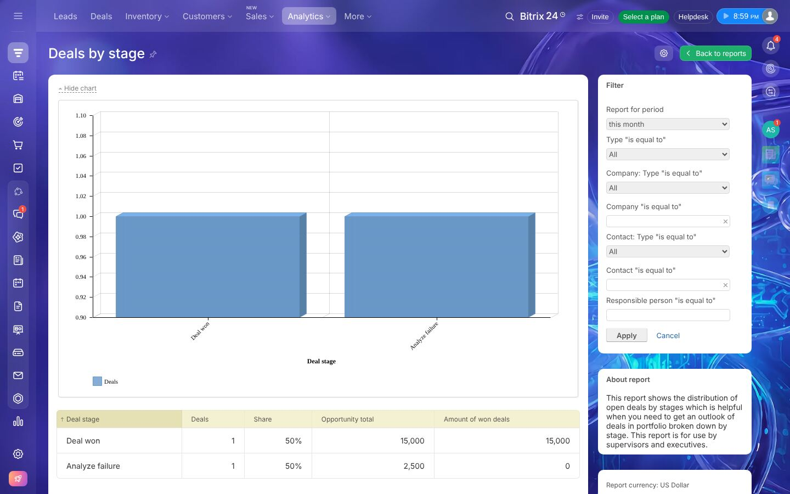 |
| Deals by sales rep | 2 deals, 0 open, 50 % lost, 50 % won, avg 8,750, total 17,500, won 15,000 | ✅ |
| Deal analytics summary / KPI / Lead generation / Sales trend | BI Builder upsell | ❌ paid plan |

📌 Dashboard KPIs must update immediately (computed from live data, cached ≤ 60 s).

---

## 9. Automation

| # | Step | Result |
|---|---|---|
| 9.1 | Open *Automation rules* for Default pipeline. | ✅ Board: stage columns; *Triggers* row; *Automation rules* row with ~15 default rules. 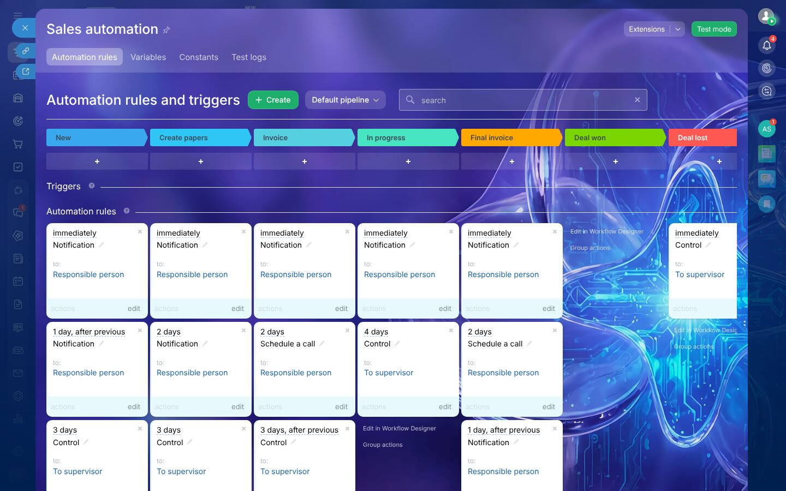 |
| 9.2 | *+* on *New* → catalogue. | ✅ 17 groups (Customer communication, Employee alerts, …). 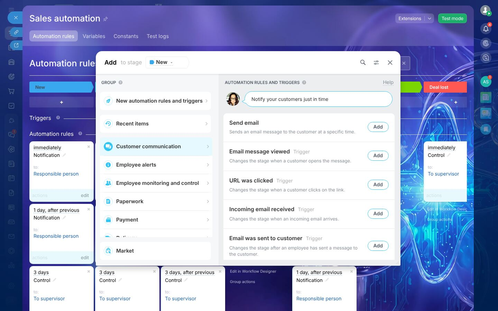 |
| 9.3 | *Add comment to item*: text, **Execution: In parallel**, **Time: Immediately**, Save → Save board. | ✅ 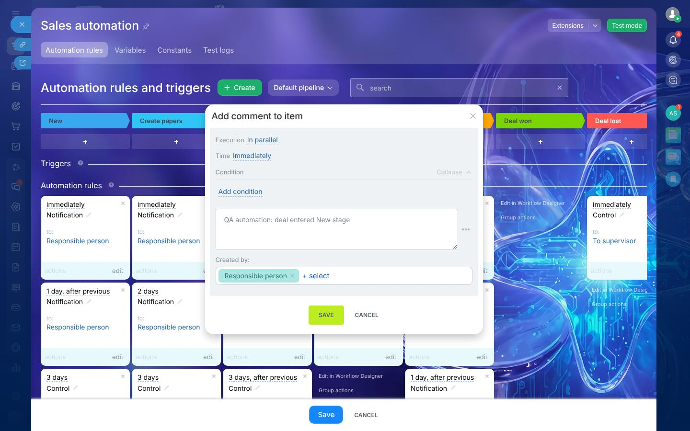 |
| 9.4 | Create deal "TEST-QA Automation trigger deal" in *New*. | ✅ Comment "QA automation: deal entered New stage" present within seconds. |

📌 Automation MVP: rules attached to **pipeline stage** with trigger *on enter stage* (and
*on create*, *on field change*, *activity overdue* later), optional **delay** (minutes/hours/days,
business-hours aware), optional **conditions** (field op value), and actions: create activity,
notify user, add note, change field, change assignee, move stage, send webhook. Run asynchronously
with a run log visible on the record.

---

## 10. Editing, deleting, recovering

| # | Step | Result |
|---|---|---|
| 10.1 | Edit fields from detail ("edit" per section) and inline rename of title. | ✅ Every change logged in *History* tab with old → new values. 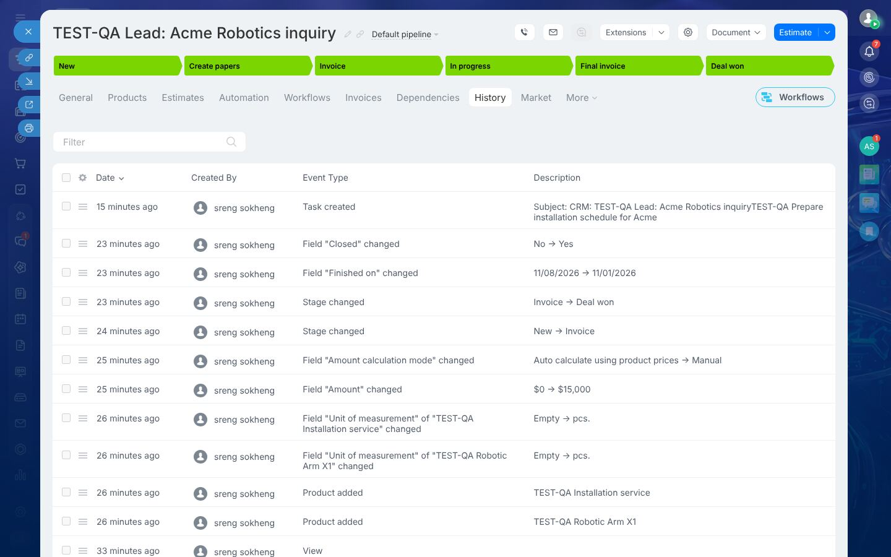 |
| 10.2 | Lead list → row menu (*View, Edit, Copy, Delete, Add to Exceptions, Generate, New e-mail, Plan, New estimate, New business process, Market*) → Delete. | ✅ Confirm "Are you sure you want to delete it?" 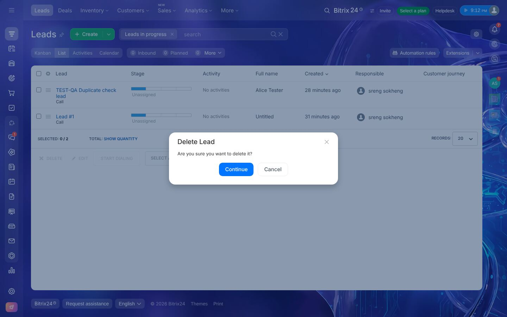 |
| 10.3 | *More → Recycle Bin*. | ✅ Item listed; "kept for 30 days"; Recover / Delete. 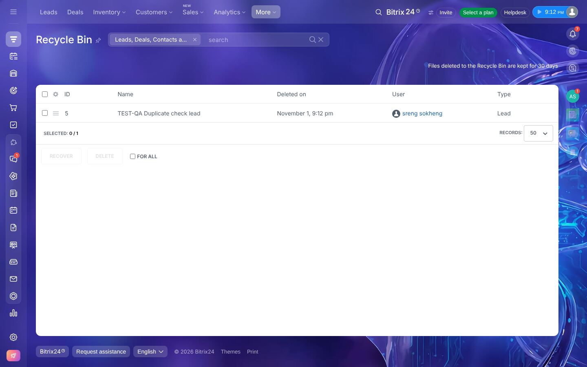 |
| 10.4 | Recover. | ⚠️ Lead restored **with a new ID (5 → 7)** — old links break. |

📌 Soft delete (`deleted_at`) with 30-day retention, restore **keeps the same ID** and links.
Undo toast right after delete. Bulk delete from lists. Hard delete purges after retention.

---

## 11. Lists: search, filter, sort, pagination

Setup: 25 contacts `QA-Bulk00…24` created via API.

| # | Test | Result |
|---|---|---|
| 11.1 | Contact list. | ✅ 20 rows/page, *Next / Last*; **total hidden** behind "Total: Show quantity". 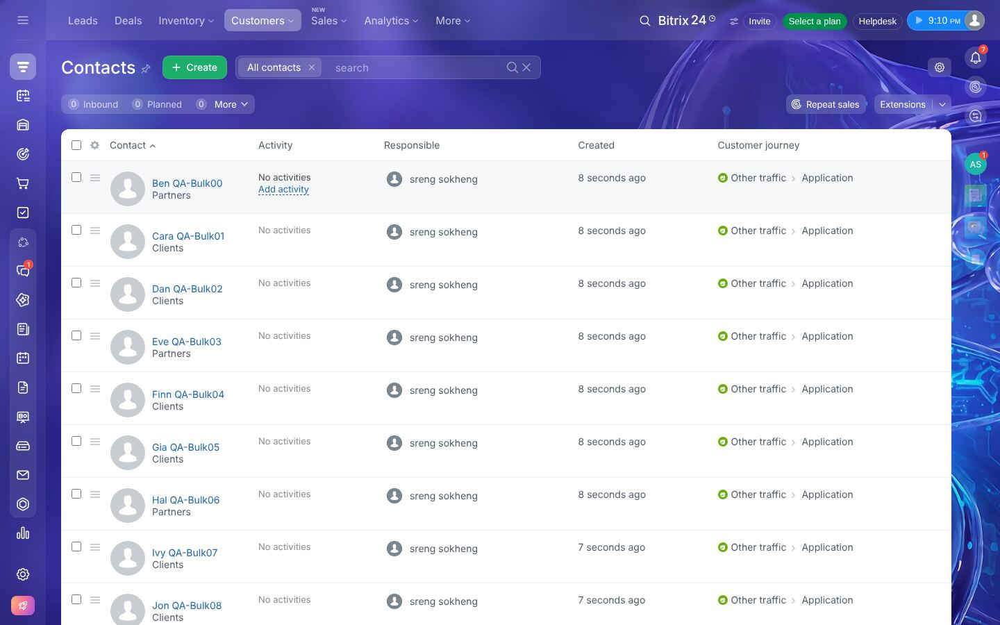 |
| 11.2 | Click search box. | ✅ Filter panel: presets (*All contacts*, *My contacts*), fields (first/last name, created by, modified by, phone, email, responsible), *Add field*, *Save filter*, *Reset*. 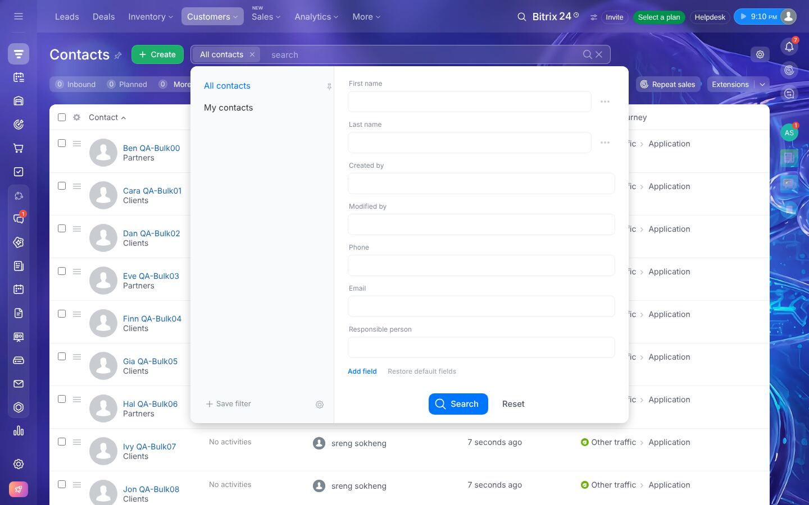 |
| 11.3 | Search "mia". | ✅ 1 result (case-insensitive, name). |
| 11.4 | Search "5550100" / "example.com" / "QA-Bulk2". | ✅ phone substring 1; email domain 20 (page); last-name prefix 5–6. |
| 11.5 | Click *Contact* column header twice. | ✅ Sort toggles asc/desc (server-side). |

📌 Lists: quick search across name/email/phone/company; filter chips; saved views (personal +
shared); column picker; sortable columns; **always show total count and sum**; page size
25/50/100; bulk select → edit field / assign / delete / export.

---

## 12. Pipelines & stages

| # | Step | Result |
|---|---|---|
| 12.1 | Pipeline dropdown → *Sales pipelines and tunnels*. | ✅ Each pipeline row with its stages (In progress / Success / Failed). 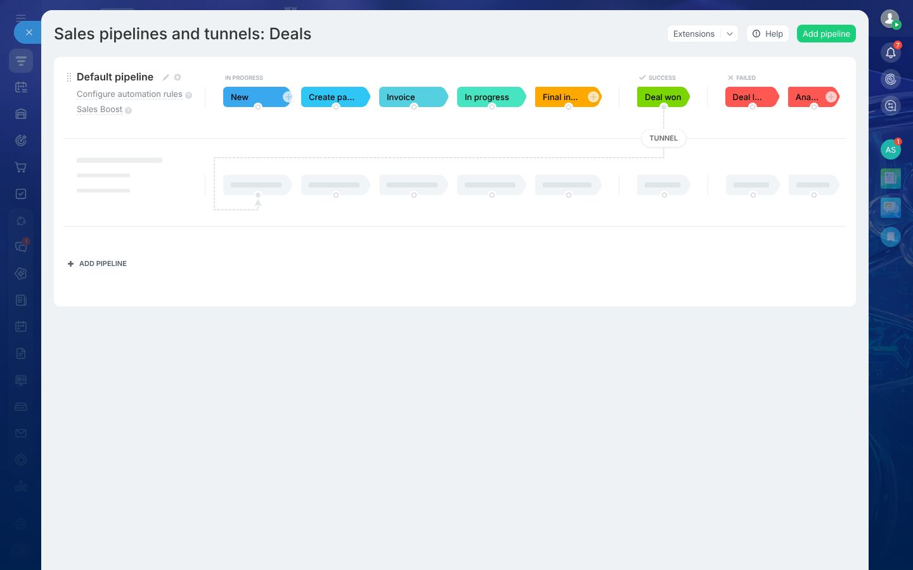 |
| 12.2 | *Add pipeline* → name "TEST-QA Partnerships" → ✓. | ✅ Created with a copy of default stages (`C1:*`). 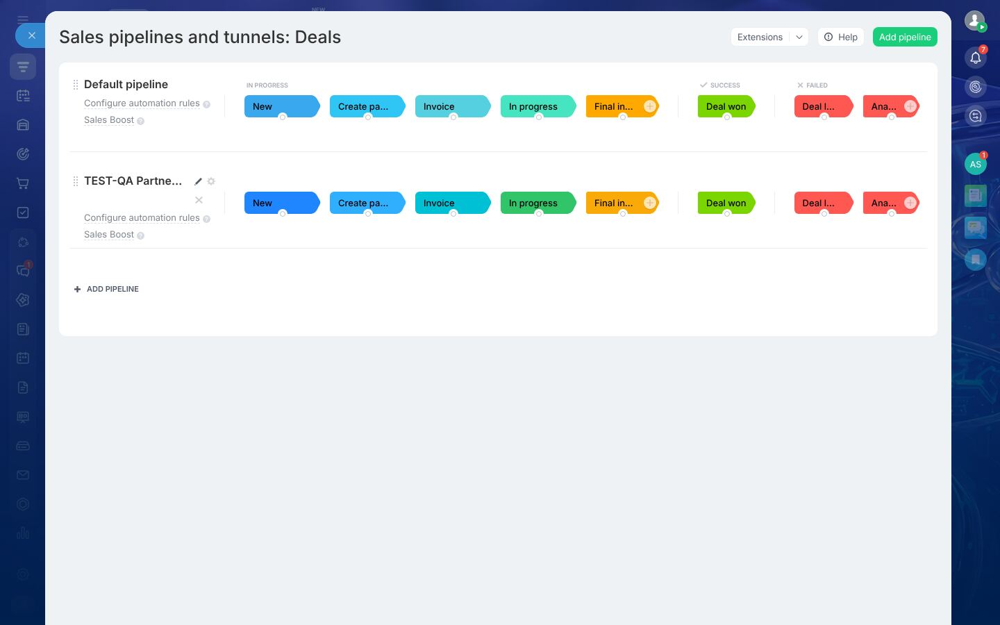 |
| 12.3 | Settings → Selection lists → deal stages. | ✅ Stage editor (initial/additional/final zones, add stage, colors, funnel preview). 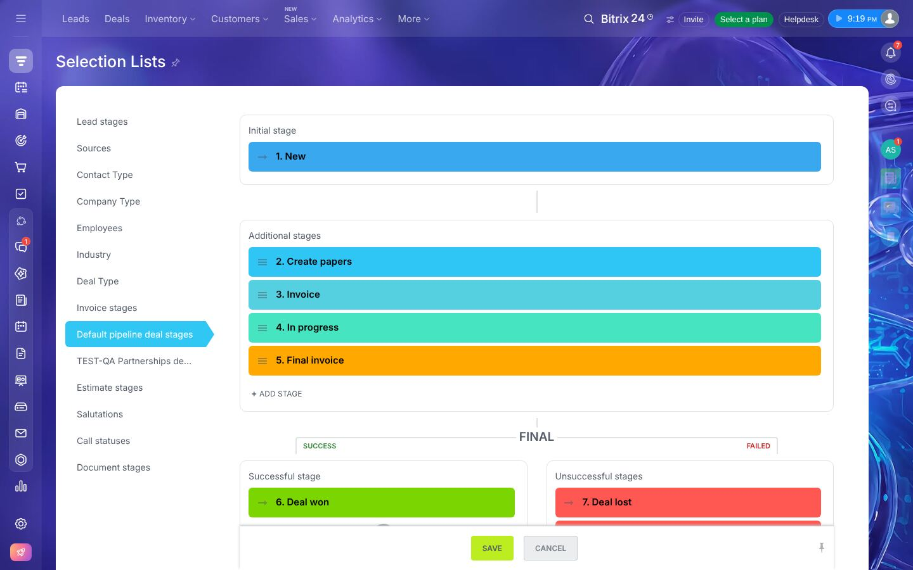 |

📌 Pipelines: CRUD, reorder; stages: name, color, order, type (open/won/lost), probability %,
optional "rotting" days (idle warning). Deleting a stage with deals requires choosing a target.

---

## 13. Permissions (observed only)

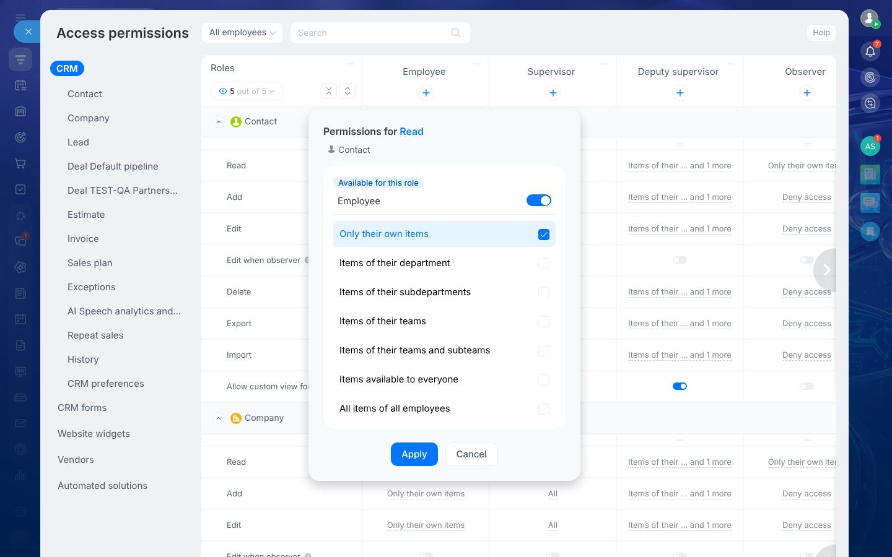

Roles × entity × action with scope *None / Own / Department / Sub-departments / Teams /
Open-to-everyone / All*. We could not verify effects with a second user.

📌 Our model: roles with per-entity actions (view, create, edit, delete, export, import) each
with scope **none | own | team | all**; plus record flag *private* vs *shared*; admin bypass;
field-level and "move to stage" permissions later.
