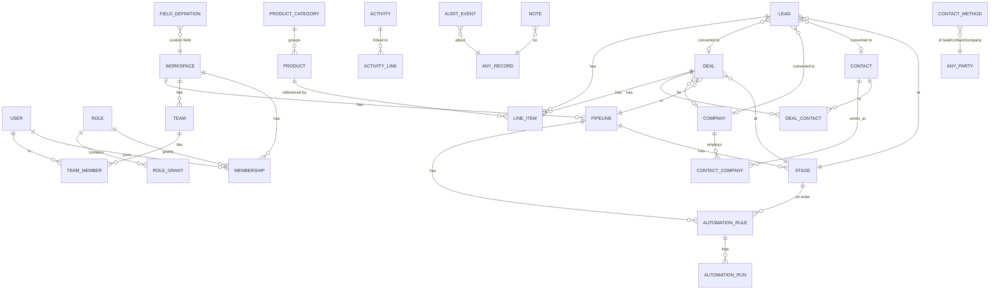

# Database Schema (PostgreSQL 16)

Design goals, informed by what we saw in Bitrix24:

- **Workspace isolation** — every business table has `workspace_id` (SaaS-ready).
- **Clean relations** instead of Bitrix24's `OWNER_TYPE_ID/OWNER_ID` everywhere — polymorphism only
  where it truly pays off (activity links, notes, audit, contact methods).
- **Stage semantics** (`open | won | lost`) on stages, like Bitrix24's P/S/F.
- **Custom fields** as definitions + a `custom jsonb` column (instead of EAV `UF_*` columns).
- **Soft delete that keeps IDs** on restore.
- **Audit everything** that changes.

Conventions: `id bigint generated always as identity`, `created_at/updated_at timestamptz default now()`,
`version int` for optimistic locking on main entities, `deleted_at timestamptz null` for soft delete,
money `numeric(18,2)` + `currency char(3)`. All FKs are within the same workspace (enforced in
services; composite FKs where cheap).

---

## 1. Entity-relationship overview

`ANY_RECORD` = `(entity_type, entity_id)` where `entity_type ∈ {lead, deal, contact, company}`.

---

## 2. Identity, workspace, access

### `workspaces`
| column | type | notes |
|---|---|---|
| id | bigint PK | |
| name | text not null | |
| slug | citext unique | |
| base_currency | char(3) default 'USD' | |
| timezone | text default 'UTC' | |
| settings | jsonb default '{}' | `{ useLeads: true, workingHours: {...} }` |

### `users`
| id | bigint PK |
|---|---|
| email | citext unique not null |
| password_hash | text not null (argon2id) |
| name | text not null |
| avatar_url | text null |
| locale, timezone | text |
| is_active | bool default true |
| last_login_at | timestamptz |

### `sessions`
`id text PK (random 32 bytes, hashed)`, `user_id → users`, `workspace_id → workspaces`,
`expires_at`, `ip`, `user_agent`, `created_at`. Index on `user_id`.

### `memberships`
`workspace_id`, `user_id`, `role_id → roles`, `status ('active','invited','disabled')`,
`invited_by`, `invite_token_hash`, PK `(workspace_id, user_id)`.

### `roles` / `role_grants`
- `roles`: `id`, `workspace_id`, `name`, `is_admin bool`, `is_system bool`.
- `role_grants`: `role_id`, `entity ('lead','deal','contact','company','product','activity','report')`,
  `action ('view','create','edit','delete','export','import')`, `scope ('none','own','team','all')`,
  PK `(role_id, entity, action)`.
- Seeded roles: **Admin** (is_admin), **Manager** (all), **Sales rep** (view team/all-shared,
  edit own), **Viewer** (view all, no edits).

### `teams` / `team_members`
`teams(id, workspace_id, name, lead_user_id)`; `team_members(team_id, user_id, PK both)`.

---

## 3. Pipelines & dictionaries

### `pipelines`
| id | bigint PK |
|---|---|
| workspace_id | FK |
| entity_type | text check in ('lead','deal') |
| name | text |
| sort | int |
| is_default | bool (one default per entity_type per workspace — partial unique index) |

### `stages`
| id | bigint PK |
|---|---|
| pipeline_id | FK on delete cascade |
| name | text |
| color | text (palette key) |
| sort | int |
| kind | text check in ('open','won','lost') — exactly one `won` per pipeline (partial unique idx) |
| probability | smallint 0–100 null |
| rot_days | int null (idle warning) |

### `dictionary_items`
Generic small lists (Bitrix24's "selection lists"): `id, workspace_id, kind ('lead_source',
'lost_reason','contact_type','company_type','industry','deal_type','company_size','disqualify_reason'),
label, sort, is_active`. Unique `(workspace_id, kind, label)`.

---

## 4. Parties: contacts & companies

### `companies`
| column | type |
|---|---|
| id, workspace_id, version | |
| name | text not null |
| type_id | FK dictionary_items null |
| industry_id | FK dictionary_items null |
| size_id | FK dictionary_items null |
| annual_revenue | numeric(18,2) null, `currency` char(3) |
| website | text null (also in contact_methods) |
| address | jsonb null `{street, city, region, postalCode, country}` |
| billing_address | jsonb null |
| description | text |
| owner_id | FK users |
| visibility | text check in ('shared','private') default 'shared' |
| source_id | FK dictionary_items null |
| custom | jsonb default '{}' |
| created_by, updated_by | FK users |
| created_at, updated_at, deleted_at, deleted_by | |

Indexes: `(workspace_id, owner_id)`, `(workspace_id, lower(name))`, GIN trigram on `name`,
GIN on `custom`, partial `where deleted_at is null`.

### `contacts`
| column | type |
|---|---|
| id, workspace_id, version | |
| first_name, last_name | text (check: at least one present) |
| salutation | text null |
| job_title | text null |
| birthday | date null |
| type_id, source_id | FK dictionary_items null |
| primary_company_id | FK companies null |
| address | jsonb null |
| description | text |
| owner_id, visibility, custom, audit columns, soft delete | as companies |

### `contact_companies`
`contact_id`, `company_id`, `role text null`, PK `(contact_id, company_id)` — many-to-many
(Bitrix24 `COMPANY_IDS`). `contacts.primary_company_id` is a denormalised pointer kept in sync.

### `contact_methods` (multi-value channels)
| column | type |
|---|---|
| id | bigint PK |
| workspace_id | FK |
| party_type | text check in ('lead','contact','company') |
| party_id | bigint |
| kind | text check in ('phone','email','website','messenger') |
| label | text ('work','mobile','home','other', messenger name…) |
| value | text (as entered) |
| normalized | text (lower-case email / E.164 digits / host) |
| is_primary | bool |

Indexes: `(workspace_id, kind, normalized)` for duplicate detection; `(party_type, party_id)`.

---

## 5. Leads & deals

### `leads`
| column | type |
|---|---|
| id, workspace_id, version | |
| title | text not null (auto-generated if empty) |
| first_name, last_name, job_title, company_name | text null |
| stage_id | FK stages (lead pipeline) |
| source_id | FK dictionary_items null |
| source_details | text null |
| amount | numeric(18,2) null, currency |
| owner_id, visibility, custom | |
| address | jsonb null |
| description | text |
| utm | jsonb null |
| converted_at | timestamptz null |
| converted_contact_id / converted_company_id / converted_deal_id | FKs null |
| disqualified_reason_id | FK dictionary_items null |
| stage_changed_at, stage_changed_by | |
| audit columns, soft delete | |

Check: `title` non-empty. Index `(workspace_id, stage_id)`, `(workspace_id, owner_id)`, trigram on
title/company_name.

### `deals`
| column | type |
|---|---|
| id, workspace_id, version | |
| title | text not null |
| pipeline_id | FK pipelines (entity_type='deal') |
| stage_id | FK stages (must belong to pipeline — trigger or service check) |
| previous_stage_id | FK stages null |
| status | text check in ('open','won','lost') (derived from stage.kind, stored for fast filters) |
| amount | numeric(18,2) not null default 0 |
| currency | char(3) |
| amount_mode | text check in ('auto','manual') default 'auto' |
| probability | smallint null (defaults from stage) |
| expected_close_date | date null |
| closed_at | timestamptz null |
| lost_reason_id | FK dictionary_items null; `lost_note` text |
| company_id | FK companies null |
| deal_type_id, source_id | FK dictionary_items null |
| lead_id | FK leads null (origin) |
| owner_id, visibility, custom, description | |
| stage_changed_at, stage_changed_by | |
| audit columns, soft delete | |

Indexes: `(workspace_id, pipeline_id, stage_id) where deleted_at is null` (Kanban),
`(workspace_id, owner_id, status)`, `(workspace_id, expected_close_date)`, `(workspace_id, closed_at)`,
trigram on title, GIN on custom.

### `deal_contacts`
`deal_id`, `contact_id`, `role text null`, `is_primary bool`, PK `(deal_id, contact_id)`.

### `deal_stage_history`
`id, deal_id, from_stage_id, to_stage_id, moved_by, moved_at, duration_seconds` — feeds velocity
and funnel reports (also mirrored in `audit_events`).

---

## 6. Products & line items

### `product_categories`
`id, workspace_id, name, parent_id null, sort`.

### `products`
| column | type |
|---|---|
| id, workspace_id | |
| name | text not null |
| sku | text null (unique per workspace when present) |
| category_id | FK null |
| description | text |
| unit_price | numeric(18,2) not null default 0 |
| currency | char(3) |
| unit | text default 'pcs' |
| tax_rate | numeric(5,2) null (percent) |
| tax_included | bool default false |
| is_active | bool default true |
| audit, soft delete | |

### `line_items`
| column | type |
|---|---|
| id | bigint PK |
| workspace_id | FK |
| parent_type | text check in ('deal','lead') |
| parent_id | bigint |
| product_id | FK products null (free-text rows allowed) |
| name | text not null (snapshot) |
| unit_price | numeric(18,2) (snapshot, before discount) |
| quantity | numeric(14,3) > 0 |
| unit | text |
| discount_type | text check in ('percent','amount') null |
| discount_value | numeric(18,2) default 0 |
| tax_rate | numeric(5,2) null |
| tax_included | bool |
| line_total | numeric(18,2) (computed by service; stored for reporting) |
| sort | int |

Deal `amount` = Σ `line_total` when `amount_mode = 'auto'` (recomputed in the same transaction).

---

## 7. Activities, notes, timeline

### `activities`
| column | type |
|---|---|
| id, workspace_id, version | |
| kind | text check in ('task','call','meeting','email','deadline') |
| subject | text not null |
| description | text |
| due_at | timestamptz null |
| duration_minutes | int null |
| all_day | bool default false |
| priority | text check in ('low','normal','high') default 'normal' |
| assignee_id | FK users |
| status | text check in ('open','done','canceled') default 'open' |
| completed_at, completed_by | |
| reminder_at | timestamptz null |
| direction | text check in ('inbound','outbound') null (calls/emails) |
| outcome | text null (call result) |
| location | text null |
| created_by, audit, soft delete | |

Indexes: `(workspace_id, assignee_id, status, due_at)` (My day / overdue),
`(workspace_id, reminder_at) where status='open'`.

### `activity_links` (Bitrix24 "bindings")
`activity_id`, `entity_type ('lead','deal','contact','company')`, `entity_id`, PK all three,
index `(entity_type, entity_id)`. Conversion moves/duplicates links to the new records.

### `notes`
`id, workspace_id, entity_type, entity_id, body text (markdown), is_pinned bool, author_id,
created_at, updated_at, deleted_at`. Index `(entity_type, entity_id, created_at desc)`.

### `audit_events`
| column | type |
|---|---|
| id | bigint PK |
| workspace_id | |
| entity_type, entity_id | |
| action | text ('created','updated','stage_changed','converted','won','lost','reopened','deleted','restored','owner_changed','linked','unlinked','merged') |
| changes | jsonb (`{"amount": ["0", "15000"]}`) |
| actor_type | text ('user','automation','system','api') |
| actor_id | bigint null |
| created_at | timestamptz |

Index `(workspace_id, entity_type, entity_id, created_at desc)`; BRIN on `created_at`.

The **timeline** is a query that unions `notes`, `activities` (through `activity_links`) and selected
`audit_events` for the record (and, for a contact/company, for its related deals/leads).

---

## 8. Custom fields

### `field_definitions`
| column | type |
|---|---|
| id | bigint PK |
| workspace_id | |
| entity_type | text ('lead','deal','contact','company','product') |
| key | text (slug, unique per workspace+entity; stored in `custom`) |
| label | text |
| type | text ('text','textarea','number','money','date','datetime','boolean','select','multiselect','url','user','file') |
| options | jsonb (`[{id, label, color}]` for selects; `{currency}` for money) |
| required | text check in ('never','always','from_stage') default 'never' |
| required_stage_ids | bigint[] (when `from_stage`) |
| help_text | text |
| section | text default 'details' |
| sort | int |
| is_active | bool (archive instead of delete; values retained) |

Values live in each entity's `custom jsonb` keyed by `key`. Validation is compiled from definitions.
Filtering uses `custom->>'key'` / `custom @> '{...}'` with a GIN index.

---

## 9. Automation & notifications

### `automation_rules`
| column | type |
|---|---|
| id, workspace_id | |
| entity_type | text ('deal','lead') |
| pipeline_id | FK |
| stage_id | FK null (null = any stage) |
| trigger | text ('stage_entered','created','field_changed','activity_overdue') |
| delay_minutes | int default 0 |
| conditions | jsonb (`[{field, op, value}]`, AND) |
| action | text ('create_activity','notify','add_note','update_field','assign_owner','move_stage','webhook') |
| config | jsonb |
| is_enabled | bool |
| sort | int |
| created_by, timestamps | |

### `automation_runs`
`id, rule_id, entity_type, entity_id, status ('scheduled','success','skipped','failed'),
scheduled_for, started_at, finished_at, error text, depth smallint`.

### `outbox_events`
`id, workspace_id, type, entity_type, entity_id, payload jsonb, depth, created_at, processed_at`.

### `notifications`
`id, workspace_id, user_id, kind, title, body, link, entity_type, entity_id, read_at, created_at`.
Index `(user_id, read_at, created_at desc)`.

---

## 10. Views & misc

### `saved_views`
`id, workspace_id, owner_id (null = shared), entity_type, name, filters jsonb, sort text,
columns text[], is_default bool`.

### `exchange_rates` (v1.1)
`workspace_id, currency, rate_to_base numeric(18,8), valid_from date`.

---

## 11. Key business rules enforced in the service layer

1. A deal's `stage_id` belongs to its `pipeline_id`; changing pipeline requires a target stage.
2. Moving to a `won`/`lost` stage sets `status`, `closed_at`; `lost` requires `lost_reason_id`
   (configurable). Moving back to `open` clears them (audited "reopened").
3. Stage change validates every field with `required = 'always'`, plus every field with
   `required = 'from_stage'` whose `required_stage_ids` contains the target stage (the admin
   picks the stages explicitly, as in Bitrix24).
4. Lead conversion is one transaction; sets `converted_*` ids and moves lead to its pipeline's
   `won` stage; open activities are re-linked to the new deal/contact/company.
5. `amount_mode='auto'` → deal amount recalculated whenever line items change.
6. Restore from recycle bin keeps the same id; purge after 30 days hard-deletes and cascades links.
7. Every mutation writes `audit_events`; every stage/won/lost/create writes an `outbox_events` row.
8. All reads/writes are filtered by `workspace_id` and the caller's role scope.
