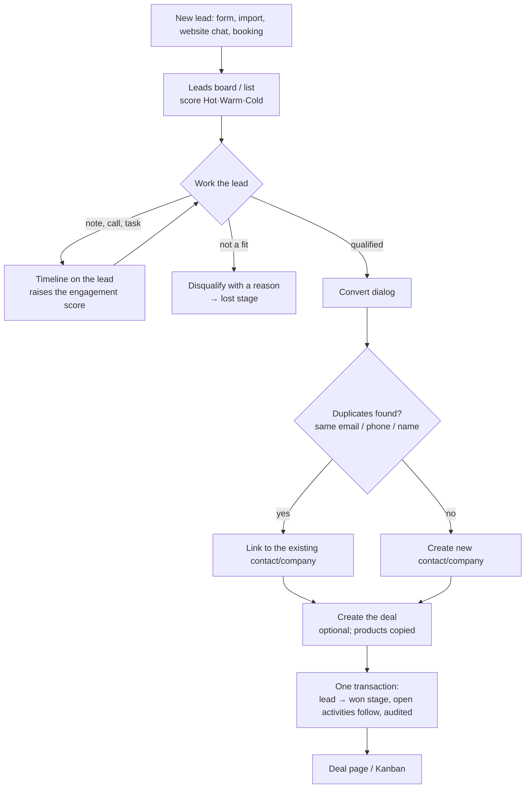
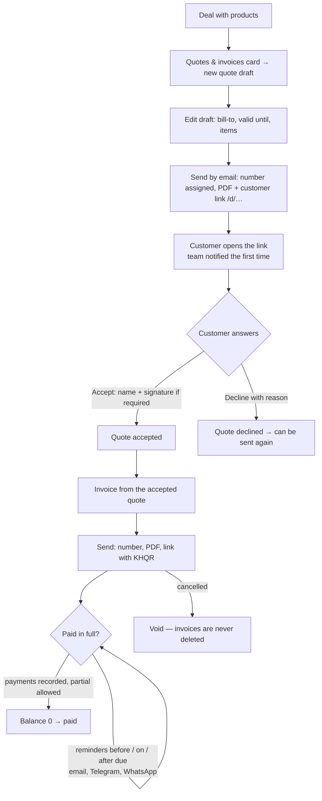
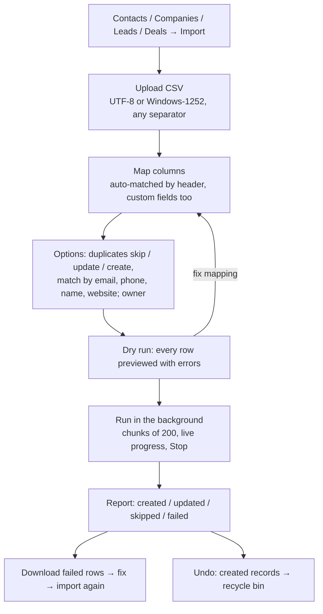
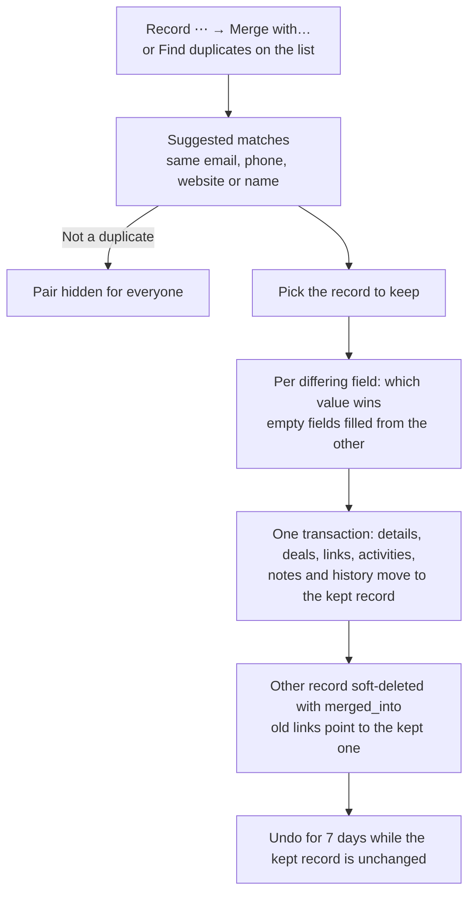
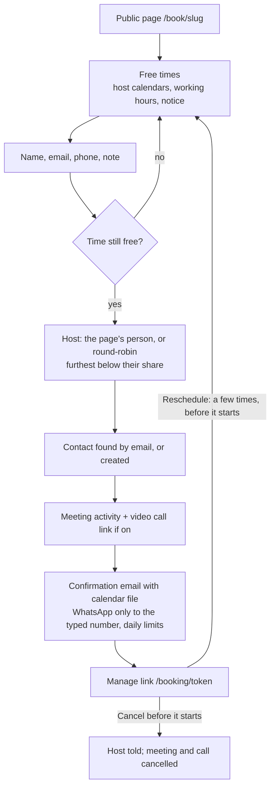

# User flows

The main journeys through the CRM, as they work today. Each diagram names the screen or API behind every step, so
use them to find your way into the code. Keep them current when a flow changes (same PR).

GitHub renders the Mermaid blocks; locally, any Mermaid preview works.

## 1. Lead → deal (qualify and convert)

`features/leads/ConvertDialog.tsx`, `POST /leads/:id/convert` (`routes/leads.ts`). Leads only reach the won stage by
converting.

## 2. Deal → quote → invoice → paid

`routes/documents.ts`, `routes/publicDocuments.ts`, `routes/reminders.ts`, `features/documents/*`.

## 3. Import a CSV

`features/imports/*`, `imports/engine.ts`. Records go through the same service functions as the forms, so validation,
required fields and the audit log are identical.

## 4. Find and merge duplicates

Needs Edit on the kept record and Delete on the merged one. `routes/merge.ts`, `routes/duplicates.ts`.

## 5. A customer books a meeting

`routes/booking.ts`, `features/booking/*`.
